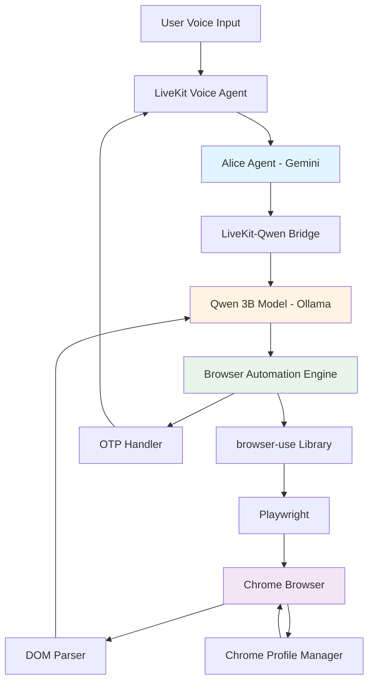
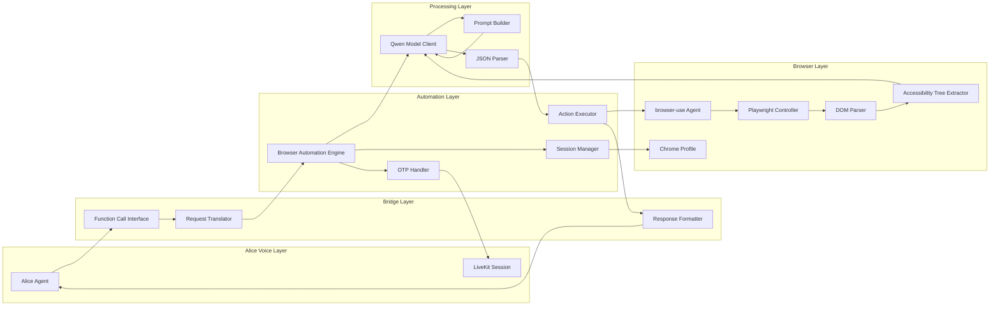
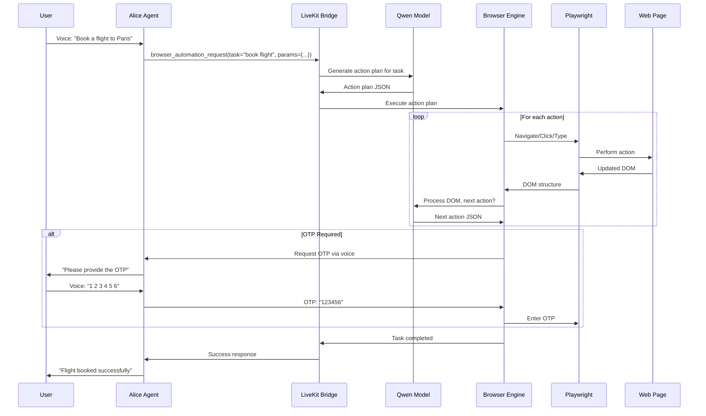
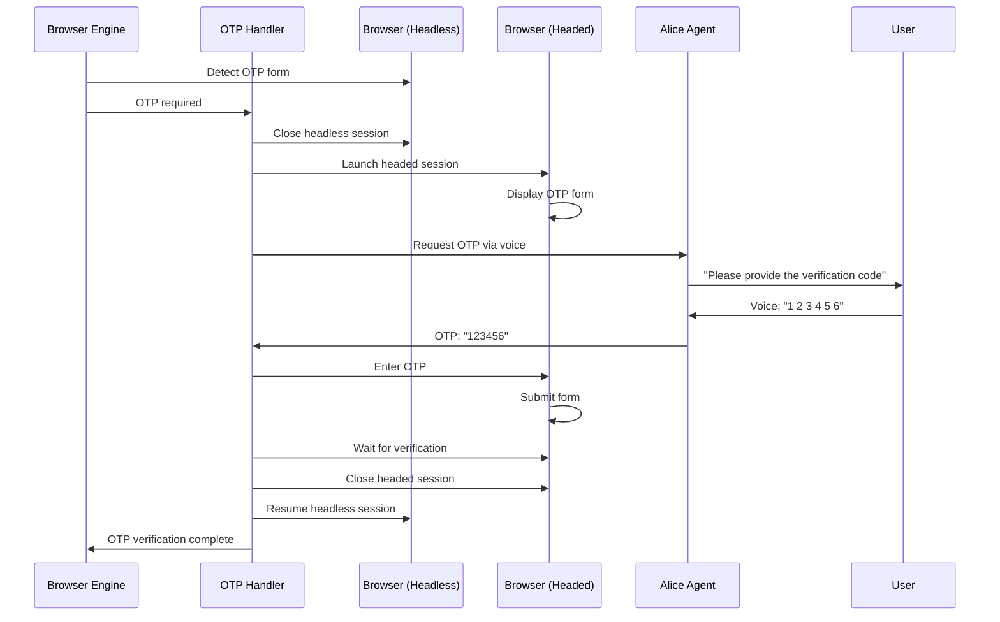
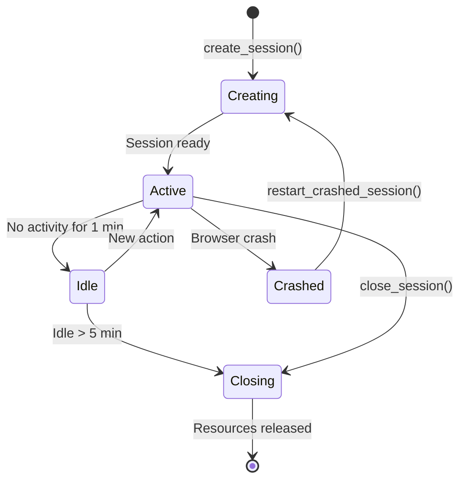

# Design Document: Alice Browser Automation

## Overview

Alice Browser Automation extends Alice's voice agent capabilities by integrating browser automation powered by a local Qwen Coder 2.5 3B model via Ollama. This design implements a DOM-first approach using the browser-use library with Playwright, ensuring high accuracy through accessibility tree parsing rather than pixel-based vision.

### Key Design Principles

1. **DOM-First Architecture**: Extract structured DOM data instead of screenshots to eliminate hallucination
2. **Local Processing**: Use Qwen 3B model via Ollama for privacy and low latency
3. **Voice-Driven Workflow**: Seamless integration with LiveKit voice agent for natural interaction
4. **Persistent Sessions**: Maintain browser profiles for authenticated sessions across restarts
5. **Graceful Degradation**: Robust error handling with fallback strategies

### System Context

The system bridges three major components:
- **Alice Voice Agent**: LiveKit-based voice interface using Gemini for conversation
- **Qwen Model**: Local 3B model for browser action planning and DOM processing
- **Browser Automation**: browser-use library with Playwright for web interaction

## Architecture

### High-Level Architecture



### Component Architecture



### Data Flow Sequence



## Components and Interfaces

### 1. Browser Automation Engine

**Responsibility**: Core orchestrator for browser automation tasks

**Interface**:
```python
class BrowserAutomationEngine:
    """Main engine coordinating browser automation tasks"""
    
    async def execute_task(
        self,
        task_description: str,
        task_type: TaskType,  # WEB_BOOKING, PROBLEM_SOLVING, APP_ACCESS
        parameters: Dict[str, Any],
        callback: Callable[[str], None]  # Progress callback to Alice
    ) -> TaskResult:
        """Execute a browser automation task"""
        pass
    
    async def initialize(self) -> bool:
        """Initialize browser-use, Playwright, and Qwen model"""
        pass
    
    async def shutdown(self) -> None:
        """Clean up resources and close browser sessions"""
        pass
    
    def get_active_sessions(self) -> List[BrowserSession]:
        """Get list of active browser sessions"""
        pass
```

**Key Methods**:
- `execute_task()`: Main entry point for automation tasks
- `_create_browser_session()`: Create new browser session with profile
- `_get_or_create_session()`: Reuse existing session for same domain
- `_close_idle_sessions()`: Clean up sessions idle > 5 minutes
- `_handle_otp_verification()`: Switch to headed mode for OTP

**Dependencies**:
- browser-use library
- Playwright
- Qwen Model Client
- Chrome Profile Manager
- OTP Handler

### 2. DOM Parser

**Responsibility**: Extract structured DOM data and accessibility tree

**Interface**:
```python
class DOMParser:
    """Parse DOM structure into LLM-friendly format"""
    
    async def parse_page(
        self,
        page: PlaywrightPage
    ) -> StructuredDOM:
        """Extract DOM structure from current page"""
        pass
    
    async def get_accessibility_tree(
        self,
        page: PlaywrightPage
    ) -> AccessibilityTree:
        """Extract accessibility tree for element identification"""
        pass
    
    def filter_interactive_elements(
        self,
        dom: StructuredDOM
    ) -> List[InteractiveElement]:
        """Filter only interactive elements (buttons, inputs, links)"""
        pass
    
    def generate_selectors(
        self,
        element: InteractiveElement
    ) -> ElementSelectors:
        """Generate CSS and XPath selectors for element"""
        pass
```

**Data Structures**:
```python
@dataclass
class StructuredDOM:
    """Structured representation of DOM"""
    url: str
    title: str
    interactive_elements: List[InteractiveElement]
    text_content: str
    metadata: Dict[str, Any]
    timestamp: datetime

@dataclass
class InteractiveElement:
    """Represents an interactive DOM element"""
    element_id: str
    tag_name: str
    role: str  # ARIA role
    label: str
    selectors: ElementSelectors
    attributes: Dict[str, str]
    position: Tuple[int, int]  # x, y coordinates
    is_visible: bool

@dataclass
class ElementSelectors:
    """Multiple selector strategies for robustness"""
    css_selector: str
    xpath: str
    aria_label: Optional[str]
    test_id: Optional[str]
    text_content: Optional[str]

@dataclass
class AccessibilityTree:
    """Browser accessibility tree structure"""
    root: AccessibilityNode
    interactive_nodes: List[AccessibilityNode]

@dataclass
class AccessibilityNode:
    """Single node in accessibility tree"""
    role: str
    name: str
    description: Optional[str]
    children: List['AccessibilityNode']
    selectors: ElementSelectors
```

**Implementation Details**:
- Use Playwright's `page.accessibility.snapshot()` for accessibility tree
- Parse DOM using `page.evaluate()` with JavaScript
- Filter decorative elements (images without alt, spacers, divs without interaction)
- Generate multiple selector strategies for robustness
- Cache parsed DOM for 2 seconds to avoid re-parsing on rapid actions

### 3. LiveKit-Qwen Bridge

**Responsibility**: Connect Alice's LiveKit agent to local Qwen model

**Interface**:
```python
class LiveKitQwenBridge:
    """Bridge between LiveKit agent and Qwen model"""
    
    def __init__(
        self,
        ollama_host: str = "http://localhost:11434",
        model_name: str = "qwen2.5-coder:3b"
    ):
        self.ollama_client = OllamaClient(ollama_host)
        self.model_name = model_name
    
    async def translate_voice_command(
        self,
        voice_command: str,
        context: Dict[str, Any]
    ) -> BrowserTask:
        """Translate voice command to browser task"""
        pass
    
    async def generate_action_plan(
        self,
        task: BrowserTask,
        dom: StructuredDOM
    ) -> List[BrowserAction]:
        """Generate action plan from task and DOM"""
        pass
    
    async def get_next_action(
        self,
        current_state: BrowserState,
        dom: StructuredDOM,
        previous_actions: List[BrowserAction]
    ) -> Optional[BrowserAction]:
        """Get next action based on current state"""
        pass
    
    def validate_model_availability(self) -> bool:
        """Check if Qwen model is available via Ollama"""
        pass
```

**Function Calling Interface**:
```python
# Register with Alice agent as a tool
@llm.ai_callable()
async def browser_automation(
    task_description: Annotated[str, "Description of the browser task"],
    task_type: Annotated[str, "Type: web_booking, problem_solving, or app_access"],
    parameters: Annotated[Dict[str, Any], "Task-specific parameters"]
) -> str:
    """
    Execute browser automation task through voice command.
    
    Examples:
    - "Book a flight to Paris on December 25th"
    - "Find solution for Python import error"
    - "Check my Gmail inbox"
    """
    bridge = LiveKitQwenBridge()
    engine = BrowserAutomationEngine()
    
    # Translate and execute
    task = await bridge.translate_voice_command(task_description, parameters)
    result = await engine.execute_task(task, task_type, parameters, 
                                       callback=alice_progress_callback)
    
    return result.summary
```

**Data Structures**:
```python
@dataclass
class BrowserTask:
    """High-level browser task"""
    task_id: str
    description: str
    task_type: TaskType
    parameters: Dict[str, Any]
    target_url: Optional[str]
    expected_outcome: str

@dataclass
class BrowserAction:
    """Single browser action"""
    action_type: ActionType  # NAVIGATE, CLICK, TYPE, WAIT, EXTRACT, SCROLL
    target_selector: Optional[ElementSelectors]
    parameters: Dict[str, Any]
    expected_result: str
    retry_count: int = 0

@dataclass
class BrowserState:
    """Current browser state"""
    url: str
    dom: StructuredDOM
    cookies: List[Dict[str, Any]]
    local_storage: Dict[str, str]
    session_storage: Dict[str, str]
    screenshot_path: Optional[str]
```

### 4. Qwen Model Client

**Responsibility**: Interface with Ollama for Qwen model inference

**Interface**:
```python
class QwenModelClient:
    """Client for Qwen model via Ollama"""
    
    def __init__(
        self,
        host: str = "http://localhost:11434",
        model: str = "qwen2.5-coder:3b",
        timeout: int = 30
    ):
        self.host = host
        self.model = model
        self.timeout = timeout
    
    async def generate_with_prompt(
        self,
        system_prompt: str,
        user_prompt: str,
        few_shot_examples: List[Dict[str, str]] = None
    ) -> str:
        """Generate response with few-shot examples"""
        pass
    
    async def generate_json_response(
        self,
        prompt: str,
        schema: Dict[str, Any]
    ) -> Dict[str, Any]:
        """Generate JSON response matching schema"""
        pass
    
    def validate_json_output(
        self,
        output: str,
        schema: Dict[str, Any]
    ) -> Tuple[bool, Optional[Dict[str, Any]]]:
        """Validate and parse JSON output"""
        pass
```

**Prompt Templates**:
```python
SYSTEM_PROMPT = """You are a browser automation assistant. You analyze web page DOM structures and generate precise browser actions in JSON format.

Your responses must be valid JSON following this schema:
{
  "action_type": "navigate|click|type|wait|extract|scroll",
  "target_selector": {
    "css_selector": "string",
    "xpath": "string",
    "aria_label": "string|null"
  },
  "parameters": {
    // Action-specific parameters
  },
  "expected_result": "string"
}

Rules:
1. Always use the most specific selector available
2. Prefer ARIA labels and test IDs over generic CSS selectors
3. Include expected_result to verify action success
4. For type actions, include "text" in parameters
5. For wait actions, include "condition" and "timeout_ms" in parameters
"""

FEW_SHOT_EXAMPLES = [
    {
        "user": "Click the login button. DOM: <button aria-label='Sign in' class='btn-primary'>Login</button>",
        "assistant": json.dumps({
            "action_type": "click",
            "target_selector": {
                "css_selector": "button.btn-primary",
                "xpath": "//button[@aria-label='Sign in']",
                "aria_label": "Sign in"
            },
            "parameters": {},
            "expected_result": "Navigation to login page or form submission"
        })
    },
    {
        "user": "Type 'john@example.com' in email field. DOM: <input type='email' id='email' placeholder='Email'>",
        "assistant": json.dumps({
            "action_type": "type",
            "target_selector": {
                "css_selector": "input#email",
                "xpath": "//input[@type='email']",
                "aria_label": null
            },
            "parameters": {
                "text": "john@example.com",
                "clear_first": true
            },
            "expected_result": "Email field contains 'john@example.com'"
        })
    },
    {
        "user": "Navigate to booking page",
        "assistant": json.dumps({
            "action_type": "navigate",
            "target_selector": null,
            "parameters": {
                "url": "https://example.com/booking",
                "wait_until": "networkidle"
            },
            "expected_result": "Page loaded with booking form visible"
        })
    },
    {
        "user": "Wait for search results to load. DOM shows loading spinner",
        "assistant": json.dumps({
            "action_type": "wait",
            "target_selector": {
                "css_selector": ".search-results",
                "xpath": "//div[@class='search-results']",
                "aria_label": null
            },
            "parameters": {
                "condition": "visible",
                "timeout_ms": 5000
            },
            "expected_result": "Search results visible on page"
        })
    },
    {
        "user": "Extract booking confirmation number. DOM: <div class='confirmation'>Booking #ABC123</div>",
        "assistant": json.dumps({
            "action_type": "extract",
            "target_selector": {
                "css_selector": "div.confirmation",
                "xpath": "//div[@class='confirmation']",
                "aria_label": null
            },
            "parameters": {
                "extract_type": "text",
                "pattern": r"Booking #(\w+)"
            },
            "expected_result": "Extracted confirmation number: ABC123"
        })
    }
]
```

### 5. OTP Handler

**Responsibility**: Manage OTP verification through voice interaction

**Interface**:
```python
class OTPHandler:
    """Handle OTP verification via LiveKit voice"""
    
    def __init__(self, livekit_session: AgentSession):
        self.session = livekit_session
    
    async def request_otp(
        self,
        context: str = "verification code"
    ) -> str:
        """Request OTP from user via voice"""
        pass
    
    async def switch_to_headed_mode(
        self,
        browser_session: BrowserSession
    ) -> None:
        """Switch browser to headed mode for OTP visibility"""
        pass
    
    async def enter_otp(
        self,
        page: PlaywrightPage,
        otp: str,
        input_selector: ElementSelectors
    ) -> bool:
        """Enter OTP in verification form"""
        pass
    
    async def switch_to_headless_mode(
        self,
        browser_session: BrowserSession
    ) -> None:
        """Switch back to headless mode after OTP"""
        pass
```

**OTP Flow**:


### 6. Chrome Profile Manager

**Responsibility**: Manage persistent browser profiles for authenticated sessions

**Interface**:
```python
class ChromeProfileManager:
    """Manage Chrome profiles for persistent sessions"""
    
    def __init__(self, profiles_dir: str = "~/.alice/browser_profiles"):
        self.profiles_dir = Path(profiles_dir).expanduser()
    
    def get_or_create_profile(
        self,
        profile_name: str = "default"
    ) -> Path:
        """Get existing profile or create new one"""
        pass
    
    def list_profiles(self) -> List[str]:
        """List all available profiles"""
        pass
    
    def delete_profile(self, profile_name: str) -> bool:
        """Delete a profile and its data"""
        pass
    
    def encrypt_credentials(
        self,
        profile_name: str,
        credentials: Dict[str, str]
    ) -> None:
        """Encrypt and store credentials in system keychain"""
        pass
    
    def get_credentials(
        self,
        profile_name: str
    ) -> Optional[Dict[str, str]]:
        """Retrieve encrypted credentials from keychain"""
        pass
```

**Profile Structure**:
```
~/.alice/browser_profiles/
├── default/
│   ├── cookies.db          # Encrypted cookies
│   ├── local_storage/      # Local storage data
│   ├── session_storage/    # Session storage data
│   ├── preferences.json    # Browser preferences
│   └── extensions/         # Browser extensions
├── work/
│   └── ...
└── personal/
    └── ...
```

**Security Considerations**:
- Use system keychain (macOS Keychain, Windows Credential Manager, Linux Secret Service)
- Encrypt cookies database with AES-256
- Never log sensitive data (passwords, credit cards, OTPs)
- Clear sensitive form data from memory after use
- Validate SSL certificates for all HTTPS connections

### 7. Session Manager

**Responsibility**: Manage browser session lifecycle and resource limits

**Interface**:
```python
class SessionManager:
    """Manage browser session lifecycle"""
    
    def __init__(
        self,
        max_concurrent_sessions: int = 3,
        idle_timeout_seconds: int = 300
    ):
        self.max_concurrent_sessions = max_concurrent_sessions
        self.idle_timeout = idle_timeout_seconds
        self.active_sessions: Dict[str, BrowserSession] = {}
    
    async def create_session(
        self,
        profile_name: str = "default",
        headless: bool = True
    ) -> BrowserSession:
        """Create new browser session"""
        pass
    
    async def get_session_for_domain(
        self,
        domain: str
    ) -> Optional[BrowserSession]:
        """Get existing session for domain or None"""
        pass
    
    async def close_session(self, session_id: str) -> None:
        """Close specific session"""
        pass
    
    async def close_idle_sessions(self) -> int:
        """Close sessions idle > timeout, return count closed"""
        pass
    
    async def restart_crashed_session(
        self,
        session_id: str
    ) -> BrowserSession:
        """Restart crashed session"""
        pass
```

**Session Lifecycle**:


## Data Models

### Task Types

```python
from enum import Enum

class TaskType(Enum):
    """Types of browser automation tasks"""
    WEB_BOOKING = "web_booking"
    PROBLEM_SOLVING = "problem_solving"
    APP_ACCESS = "app_access"

class ActionType(Enum):
    """Types of browser actions"""
    NAVIGATE = "navigate"
    CLICK = "click"
    TYPE = "type"
    WAIT = "wait"
    EXTRACT = "extract"
    SCROLL = "scroll"
    SELECT = "select"
    UPLOAD = "upload"
    DOWNLOAD = "download"
```

### Task Results

```python
@dataclass
class TaskResult:
    """Result of browser automation task"""
    task_id: str
    success: bool
    summary: str
    actions_taken: List[BrowserAction]
    extracted_data: Dict[str, Any]
    error: Optional[str]
    duration_seconds: float
    screenshots: List[str]  # Paths to screenshots
```

### Browser Session

```python
@dataclass
class BrowserSession:
    """Active browser session"""
    session_id: str
    profile_name: str
    domain: str
    playwright_context: BrowserContext
    playwright_page: Page
    created_at: datetime
    last_activity: datetime
    is_headless: bool
    state: SessionState

class SessionState(Enum):
    """Browser session states"""
    CREATING = "creating"
    ACTIVE = "active"
    IDLE = "idle"
    CRASHED = "crashed"
    CLOSING = "closing"
```

## Action Suites Implementation

### 1. Web Bookings Action Suite

**Supported Booking Types**:
- Travel bookings (flights, hotels, car rentals)
- Food delivery (restaurant orders)
- Event bookings (tickets, reservations)

**Implementation**:
```python
class WebBookingsActionSuite:
    """Handle web booking automation"""
    
    async def book_travel(
        self,
        booking_type: str,  # flight, hotel, car
        details: TravelBookingDetails
    ) -> TaskResult:
        """
        Automate travel booking process
        
        Steps:
        1. Navigate to booking website
        2. Fill search form (dates, destinations, preferences)
        3. Browse results and select option
        4. Fill passenger/guest details
        5. Handle payment (with user confirmation)
        6. Handle OTP if required
        7. Extract confirmation details
        """
        pass
    
    async def order_food(
        self,
        restaurant: str,
        items: List[str],
        delivery_address: str
    ) -> TaskResult:
        """
        Automate food delivery order
        
        Steps:
        1. Navigate to food delivery platform
        2. Search for restaurant
        3. Browse menu and add items to cart
        4. Proceed to checkout
        5. Confirm delivery address
        6. Handle payment
        7. Extract order confirmation
        """
        pass
    
    async def book_event(
        self,
        event_name: str,
        ticket_details: EventTicketDetails
    ) -> TaskResult:
        """
        Automate event ticket booking
        
        Steps:
        1. Navigate to ticketing platform
        2. Search for event
        3. Select date and time
        4. Choose seats/tickets
        5. Fill attendee details
        6. Handle payment
        7. Extract booking confirmation
        """
        pass
```

**Data Models**:
```python
@dataclass
class TravelBookingDetails:
    """Travel booking parameters"""
    booking_type: str  # flight, hotel, car
    origin: Optional[str]
    destination: str
    departure_date: date
    return_date: Optional[date]
    passengers: int
    class_preference: Optional[str]  # economy, business, first
    preferences: Dict[str, Any]  # flexible_dates, direct_flights, etc.

@dataclass
class EventTicketDetails:
    """Event ticket booking parameters"""
    event_name: str
    venue: Optional[str]
    date: date
    time: Optional[str]
    ticket_count: int
    seat_preference: Optional[str]
    ticket_type: Optional[str]  # VIP, general, etc.
```

### 2. Desktop Problem Solving Action Suite

**Capabilities**:
- Web research for technical solutions
- Integration with Open Interpreter for command execution
- Solution verification and reporting

**Implementation**:
```python
class ProblemSolvingActionSuite:
    """Handle desktop problem solving through web research"""
    
    def __init__(self, open_interpreter_client: OpenInterpreterClient):
        self.interpreter = open_interpreter_client
    
    async def solve_problem(
        self,
        problem_description: str,
        system_info: Dict[str, Any]
    ) -> TaskResult:
        """
        Research and solve desktop problem
        
        Steps:
        1. Search for solutions using web search
        2. Navigate through search results
        3. Extract relevant solutions
        4. Rank solutions by relevance
        5. Present solutions to user
        6. Execute approved solution via Open Interpreter
        7. Verify solution effectiveness
        """
        pass
    
    async def search_solutions(
        self,
        query: str
    ) -> List[Solution]:
        """Search web for problem solutions"""
        pass
    
    async def extract_solution_steps(
        self,
        url: str
    ) -> Solution:
        """Extract solution steps from webpage"""
        pass
    
    async def execute_solution(
        self,
        solution: Solution,
        user_approved: bool
    ) -> ExecutionResult:
        """Execute solution via Open Interpreter"""
        pass
```

**Data Models**:
```python
@dataclass
class Solution:
    """Problem solution from web research"""
    title: str
    source_url: str
    steps: List[str]
    commands: List[str]  # Shell commands to execute
    relevance_score: float
    platform: str  # windows, linux, macos
    risk_level: str  # low, medium, high

@dataclass
class ExecutionResult:
    """Result of solution execution"""
    success: bool
    output: str
    error: Optional[str]
    verification_passed: bool
```

### 3. Application Accessing Action Suite

**Capabilities**:
- Access web applications with persistent login
- Navigate applications based on voice commands
- Extract information and report to user

**Implementation**:
```python
class ApplicationAccessActionSuite:
    """Handle web application access and navigation"""
    
    async def access_application(
        self,
        app_name: str,
        action: str,
        parameters: Dict[str, Any]
    ) -> TaskResult:
        """
        Access web application and perform action
        
        Steps:
        1. Load Chrome profile for app
        2. Navigate to application URL
        3. Check if logged in
        4. Authenticate if session expired
        5. Navigate to requested section
        6. Perform requested action
        7. Extract and return information
        """
        pass
    
    async def check_authentication(
        self,
        page: Page,
        app_config: AppConfig
    ) -> bool:
        """Check if user is authenticated"""
        pass
    
    async def authenticate(
        self,
        page: Page,
        app_config: AppConfig
    ) -> bool:
        """Authenticate user if session expired"""
        pass
    
    async def navigate_to_section(
        self,
        page: Page,
        section: str,
        app_config: AppConfig
    ) -> bool:
        """Navigate to specific section of application"""
        pass
```

**Application Configuration**:
```python
@dataclass
class AppConfig:
    """Configuration for web application"""
    app_name: str
    url: str
    login_url: str
    login_selectors: Dict[str, ElementSelectors]
    authenticated_indicator: ElementSelectors
    navigation_map: Dict[str, str]  # section -> URL path
    profile_name: str

# Example configurations
APP_CONFIGS = {
    "gmail": AppConfig(
        app_name="Gmail",
        url="https://mail.google.com",
        login_url="https://accounts.google.com",
        login_selectors={
            "email": ElementSelectors(css_selector="input[type='email']", ...),
            "password": ElementSelectors(css_selector="input[type='password']", ...),
        },
        authenticated_indicator=ElementSelectors(css_selector="div[role='navigation']", ...),
        navigation_map={
            "inbox": "/mail/u/0/#inbox",
            "sent": "/mail/u/0/#sent",
            "drafts": "/mail/u/0/#drafts",
        },
        profile_name="personal"
    ),
    # Add more app configs...
}
```

## Error Handling

### Error Types and Recovery Strategies

```python
class BrowserAutomationError(Exception):
    """Base exception for browser automation errors"""
    pass

class ElementNotFoundError(BrowserAutomationError):
    """Element selector failed"""
    pass

class PageLoadTimeoutError(BrowserAutomationError):
    """Page load timeout"""
    pass

class InvalidActionError(BrowserAutomationError):
    """Qwen generated invalid action"""
    pass

class NetworkError(BrowserAutomationError):
    """Network connectivity issue"""
    pass

class SessionCrashedError(BrowserAutomationError):
    """Browser session crashed"""
    pass

class QwenModelUnavailableError(BrowserAutomationError):
    """Qwen model not available"""
    pass
```

### Error Handling Strategy

```python
class ErrorHandler:
    """Handle browser automation errors with recovery"""
    
    async def handle_element_not_found(
        self,
        error: ElementNotFoundError,
        dom: StructuredDOM
    ) -> Optional[BrowserAction]:
        """
        Recovery: Try alternative selectors from accessibility tree
        
        1. Get all selectors for target element
        2. Try CSS selector
        3. Try XPath
        4. Try ARIA label
        5. Try text content match
        6. If all fail, ask Qwen for alternative element
        """
        pass
    
    async def handle_page_load_timeout(
        self,
        error: PageLoadTimeoutError,
        url: str,
        retry_count: int
    ) -> bool:
        """
        Recovery: Retry navigation up to 2 times
        
        1. Check network connectivity
        2. Retry with longer timeout
        3. If still fails, report to user
        """
        pass
    
    async def handle_invalid_action(
        self,
        error: InvalidActionError,
        invalid_json: str,
        context: Dict[str, Any]
    ) -> BrowserAction:
        """
        Recovery: Request corrected action from Qwen
        
        1. Parse error details
        2. Build correction prompt with error context
        3. Request new action from Qwen
        4. Validate new action
        5. If still invalid after 3 attempts, fail task
        """
        pass
    
    async def handle_session_crashed(
        self,
        error: SessionCrashedError,
        session_id: str
    ) -> BrowserSession:
        """
        Recovery: Restart session and retry task
        
        1. Log crash details
        2. Close crashed session
        3. Create new session with same profile
        4. Restore state (navigate to last URL)
        5. Resume task from last successful action
        """
        pass
```

### Retry Configuration

```python
@dataclass
class RetryConfig:
    """Configuration for retry behavior"""
    max_retries: int = 2
    retry_delay_seconds: float = 1.0
    exponential_backoff: bool = True
    backoff_multiplier: float = 2.0
    
    # Error-specific retry limits
    element_not_found_retries: int = 3
    page_load_retries: int = 2
    invalid_action_retries: int = 3
    network_error_retries: int = 2
```

## Testing Strategy

### Unit Testing

**Test Coverage Areas**:
1. DOM Parser
   - Parse various HTML structures
   - Extract accessibility tree correctly
   - Filter interactive elements
   - Generate valid selectors

2. Qwen Model Client
   - Generate valid JSON responses
   - Handle few-shot examples
   - Validate JSON against schema
   - Handle model unavailability

3. Chrome Profile Manager
   - Create and manage profiles
   - Encrypt/decrypt credentials
   - Handle profile deletion

4. Session Manager
   - Create and close sessions
   - Enforce concurrent session limits
   - Close idle sessions
   - Restart crashed sessions

5. Error Handler
   - Retry with alternative selectors
   - Handle page load timeouts
   - Recover from invalid actions
   - Restart crashed sessions

**Example Unit Tests**:
```python
import pytest
from alice_browser_automation import DOMParser, StructuredDOM

class TestDOMParser:
    @pytest.fixture
    async def parser(self):
        return DOMParser()
    
    @pytest.mark.asyncio
    async def test_parse_simple_form(self, parser, mock_page):
        """Test parsing a simple login form"""
        # Arrange
        mock_page.content = """
        <form>
            <input type="email" id="email" aria-label="Email">
            <input type="password" id="password" aria-label="Password">
            <button type="submit">Login</button>
        </form>
        """
        
        # Act
        dom = await parser.parse_page(mock_page)
        
        # Assert
        assert len(dom.interactive_elements) == 3
        assert dom.interactive_elements[0].tag_name == "input"
        assert dom.interactive_elements[0].role == "textbox"
        assert dom.interactive_elements[2].tag_name == "button"
    
    @pytest.mark.asyncio
    async def test_filter_decorative_elements(self, parser, mock_page):
        """Test filtering out decorative elements"""
        # Arrange
        mock_page.content = """
        <div>
              <!-- Decorative -->
              <!-- Not decorative -->
            <div class="spacer"></div>  <!-- Decorative -->
            <button>Click me</button>  <!-- Interactive -->
        </div>
        """
        
        # Act
        dom = await parser.parse_page(mock_page)
        elements = parser.filter_interactive_elements(dom)
        
        # Assert
        assert len(elements) == 2  # Only profile image and button
        assert elements[0].tag_name == "img"
        assert elements[1].tag_name == "button"
```

### Integration Testing

**Test Scenarios**:
1. End-to-end booking flow
2. OTP verification flow
3. Application access with authentication
4. Problem solving with web research
5. Session persistence across restarts
6. Error recovery scenarios

**Example Integration Test**:
```python
@pytest.mark.integration
@pytest.mark.asyncio
async def test_web_booking_flow():
    """Test complete web booking flow"""
    # Arrange
    engine = BrowserAutomationEngine()
    await engine.initialize()
    
    task_params = {
        "booking_type": "flight",
        "origin": "SFO",
        "destination": "CDG",
        "departure_date": "2025-12-25",
        "passengers": 1
    }
    
    # Act
    result = await engine.execute_task(
        task_description="Book a flight to Paris",
        task_type=TaskType.WEB_BOOKING,
        parameters=task_params,
        callback=lambda msg: print(f"Progress: {msg}")
    )
    
    # Assert
    assert result.success
    assert "confirmation" in result.extracted_data
    assert len(result.actions_taken) > 0
    assert result.error is None
    
    # Cleanup
    await engine.shutdown()
```

### Manual Testing Checklist

- [ ] Voice command recognition accuracy
- [ ] OTP verification with real services
- [ ] Payment flow with user confirmation
- [ ] Browser profile persistence
- [ ] Session recovery after crash
- [ ] Accessibility tree parsing on complex pages
- [ ] Qwen model response quality
- [ ] Error messages clarity
- [ ] Performance under load

## Performance Optimization

### Performance Targets

| Metric | Target | Requirement |
|--------|--------|-------------|
| Browser session initialization | < 3s | Req 12.1 |
| DOM parsing | < 2s | Req 12.2 |
| Qwen action generation | < 5s | Req 12.3 |
| Simple action execution | < 1s | Req 12.4 |
| Typical booking flow | < 60s | Req 12.6 |

### Optimization Strategies

1. **DOM Parsing**
   - Cache parsed DOM for 2 seconds
   - Parse only visible viewport initially
   - Lazy-load off-screen elements
   - Use Web Workers for parsing in browser

2. **Qwen Model**
   - Keep model loaded in memory (Ollama)
   - Use streaming responses for faster TTFB
   - Batch multiple actions when possible
   - Cache common action patterns

3. **Browser Sessions**
   - Reuse sessions for same domain
   - Keep 1 warm session ready
   - Use connection pooling
   - Preload common websites

4. **Network**
   - Enable HTTP/2
   - Use CDN for static assets
   - Compress responses
   - Parallel resource loading

## Security and Privacy

### Security Measures

1. **Credential Protection**
   - Encrypt credentials with AES-256
   - Store in system keychain
   - Never log sensitive data
   - Clear from memory after use

2. **Network Security**
   - Validate SSL certificates
   - Use HTTPS only
   - Implement certificate pinning for known sites
   - Block mixed content

3. **Browser Security**
   - Run in sandboxed environment
   - Disable unnecessary browser features
   - Clear cookies/storage on profile deletion
   - Implement CSP headers

4. **User Confirmation**
   - Require voice confirmation for payments
   - Require explicit permission for banking sites
   - Show action preview before execution
   - Allow task cancellation anytime

### Privacy Considerations

1. **Data Minimization**
   - Only collect necessary data
   - Delete task data after completion
   - Don't store payment information
   - Clear browsing history periodically

2. **Local Processing**
   - All AI processing local (Qwen via Ollama)
   - No data sent to external services
   - Browser profiles stored locally
   - Encryption keys never leave device

3. **User Control**
   - User can delete profiles anytime
   - User can view stored data
   - User can disable automation
   - User can export/import profiles

## Deployment and Configuration

### Installation Requirements

```bash
# System requirements
- Python 3.10+
- Node.js 18+ (for Playwright)
- Ollama
- 8GB RAM minimum
- 10GB disk space

# Python dependencies
pip install browser-use playwright ollama-python livekit-agents

# Install Playwright browsers
playwright install chromium

# Install Ollama and Qwen model
ollama pull qwen2.5-coder:3b
```

### Configuration File

```yaml
# alice_browser_automation_config.yaml

browser:
  headless_default: true
  max_concurrent_sessions: 3
  idle_timeout_seconds: 300
  profiles_dir: "~/.alice/browser_profiles"
  default_profile: "default"
  
qwen:
  host: "http://localhost:11434"
  model: "qwen2.5-coder:3b"
  timeout_seconds: 30
  max_retries: 3
  
dom_parser:
  cache_duration_seconds: 2
  max_elements: 1000
  filter_decorative: true
  
performance:
  dom_parse_timeout: 2.0
  action_generation_timeout: 5.0
  simple_action_timeout: 1.0
  
security:
  require_payment_confirmation: true
  block_banking_sites: false  # Set to true for extra safety
  validate_ssl: true
  clear_sensitive_data: true
  
logging:
  level: "INFO"
  log_file: "~/.alice/logs/browser_automation.log"
  log_sensitive_data: false
```

### Environment Variables

```bash
# .env file
OLLAMA_HOST=http://localhost:11434
QWEN_MODEL=qwen2.5-coder:3b
BROWSER_PROFILES_DIR=~/.alice/browser_profiles
LIVEKIT_URL=wss://your-livekit-server.com
LIVEKIT_API_KEY=your-api-key
LIVEKIT_API_SECRET=your-api-secret
```

## Integration with Alice Agent

### Registering Browser Automation Tools

```python
# In agent.py

from alice_browser_automation import (
    browser_automation,
    list_browser_profiles,
    check_browser_automation_status
)

# Add to tools list
all_tools = [
    # ... existing tools ...
    browser_automation,
    list_browser_profiles,
    check_browser_automation_status,
]

# Initialize browser automation engine on startup
async def entrypoint(ctx: agents.JobContext):
    # ... existing initialization ...
    
    # Initialize browser automation
    from alice_browser_automation import BrowserAutomationEngine
    browser_engine = BrowserAutomationEngine()
    await browser_engine.initialize()
    
    # Store in context for cleanup
    ctx.browser_engine = browser_engine
    
    # ... rest of initialization ...
```

### Tool Definitions

```python
@llm.ai_callable()
async def browser_automation(
    task_description: Annotated[str, "Natural language description of the browser task"],
    task_type: Annotated[str, "Type of task: web_booking, problem_solving, or app_access"],
    parameters: Annotated[Dict[str, Any], "Task-specific parameters as JSON"] = {}
) -> str:
    """
    Execute browser automation task through voice command.
    
    Supports three types of tasks:
    1. web_booking: Book travel, food delivery, event tickets
    2. problem_solving: Research and solve desktop problems
    3. app_access: Access and navigate web applications
    
    Examples:
    - browser_automation("Book a flight to Paris on December 25th", "web_booking", {"origin": "SFO", "destination": "CDG"})
    - browser_automation("Find solution for Python import error", "problem_solving", {"error": "ModuleNotFoundError"})
    - browser_automation("Check my Gmail inbox", "app_access", {"app": "gmail", "action": "check_inbox"})
    """
    # Implementation in alice_browser_automation.py
    pass

@llm.ai_callable()
async def list_browser_profiles() -> str:
    """
    List all available browser profiles.
    
    Returns a formatted list of profiles with their names and last used dates.
    """
    pass

@llm.ai_callable()
async def check_browser_automation_status() -> str:
    """
    Check if browser automation is ready and available.
    
    Returns status of:
    - Ollama service
    - Qwen model availability
    - Playwright installation
    - Active browser sessions
    """
    pass
```

## Future Enhancements

### Phase 2 Features

1. **Multi-tab Management**
   - Handle multiple tabs simultaneously
   - Switch between tabs based on context
   - Coordinate actions across tabs

2. **Advanced Form Filling**
   - Auto-fill from user profile
   - Smart field detection
   - Address autocomplete
   - Credit card management (with encryption)

3. **Screenshot Analysis**
   - Fallback to vision when DOM insufficient
   - CAPTCHA detection and handling
   - Visual verification of actions

4. **Learning and Adaptation**
   - Learn user preferences
   - Remember successful action patterns
   - Adapt to website changes
   - Build site-specific strategies

5. **Batch Operations**
   - Execute multiple bookings
   - Bulk data extraction
   - Scheduled automation tasks

### Phase 3 Features

1. **Mobile Browser Support**
   - Mobile viewport emulation
   - Touch gesture simulation
   - Mobile-specific selectors

2. **Browser Extension Integration**
   - Ad blockers
   - Password managers
   - Privacy tools

3. **Advanced Analytics**
   - Task success rates
   - Performance metrics
   - Error patterns
   - User behavior insights

4. **Multi-language Support**
   - Detect page language
   - Translate content
   - Localized action generation

## Appendix

### Glossary of Terms

- **DOM**: Document Object Model - tree structure representing HTML
- **Accessibility Tree**: Semantic tree used by screen readers
- **Playwright**: Browser automation library
- **browser-use**: AI-powered browser automation library
- **Ollama**: Local LLM inference server
- **Qwen**: Alibaba's code-focused language model
- **LiveKit**: Real-time communication platform
- **OTP**: One-Time Password for verification
- **CDP**: Chrome DevTools Protocol

### References

1. [browser-use Documentation](https://docs.browser-use.com/)
2. [Playwright Documentation](https://playwright.dev/)
3. [Ollama Documentation](https://ollama.com/docs)
4. [Qwen Model Card](https://ollama.com/library/qwen2.5-coder)
5. [LiveKit Agents Documentation](https://docs.livekit.io/agents/)
6. [Web Accessibility Initiative - ARIA](https://www.w3.org/WAI/standards-guidelines/aria/)
7. [Chrome DevTools Protocol](https://chromedevtools.github.io/devtools-protocol/)

### API Reference

See individual component interfaces in the Components and Interfaces section above.

### Configuration Examples

See Deployment and Configuration section for complete configuration examples.
