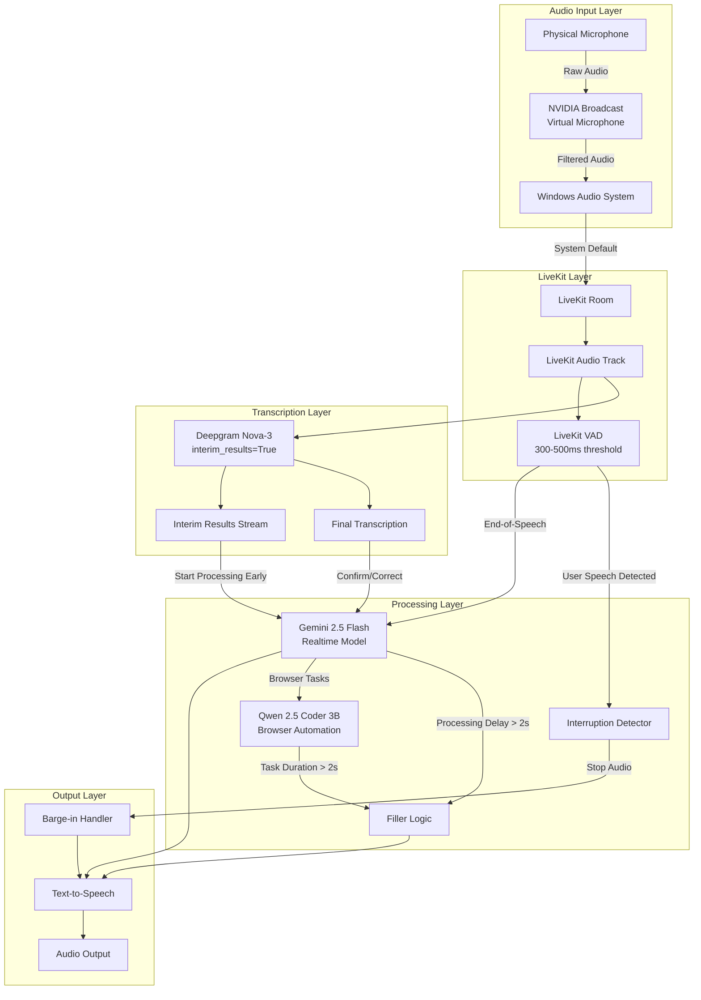

# Design Document: Alice Contextual Integration

## Overview

Alice Contextual Integration enhances the conversational experience by implementing three critical optimizations: NVIDIA Broadcast audio filtering at the system level, Deepgram Nova-3 with interim results for faster transcription, and Voice Activity Detection (VAD) tuning for natural turn-taking. Additionally, this design implements interruption handling (barge-in) and filler logic (backchanneling) to achieve Felicia-like conversational fluidity.

This feature focuses on **configuration and integration** rather than implementing new algorithms. The goal is to configure existing LiveKit, Deepgram, and NVIDIA Broadcast components to work together seamlessly, eliminating awkward pauses and enabling natural conversation flow.

### Key Design Principles

1. **System-Level Audio Filtering**: NVIDIA Broadcast filters audio before it reaches LiveKit, ensuring clean input
2. **Overlapping Processing**: Interim results enable LLM processing to begin while user is still speaking
3. **Natural Turn-Taking**: VAD silence threshold tuned to 300-500ms for human-like conversation rhythm
4. **Immediate Interruption**: Barge-in detection stops Alice's audio within 100ms when user speaks
5. **Conversational Presence**: Backchanneling and filler phrases maintain engagement during pauses

### Architecture Context

This feature integrates with the existing Alice voice agent architecture:
- **LiveKit Agent** (`agent.py`): Main entry point, manages agent session and tools
- **Browser Automation Engine** (`engine.py`): Executes browser tasks, provides progress callbacks
- **LiveKit Tools** (`livekit_tools.py`): Function tools for browser automation invocation
- **Audio Pipeline**: NVIDIA Broadcast → Windows Audio → LiveKit → Deepgram → VAD → Gemini 2.5 Flash

## Architecture

### Component Diagram



### Audio Pipeline Flow

```mermaid
sequenceDiagram
    participant User
    participant NVIDIA as NVIDIA Broadcast
    participant Windows as Windows Audio
    participant LiveKit as LiveKit Room
    participant Deepgram as Deepgram Nova-3
    participant VAD as LiveKit VAD
    participant Gemini as Gemini 2.5 Flash
    participant TTS as Text-to-Speech
    
    User->>NVIDIA: Speak (with background noise)
    NVIDIA->>NVIDIA: Apply noise suppression
    NVIDIA->>NVIDIA: Remove room echo
    NVIDIA->>Windows: Filtered audio stream
    Windows->>LiveKit: System default microphone
    LiveKit->>Deepgram: Audio chunks
    LiveKit->>VAD: Audio level monitoring
    
    Note over Deepgram: interim_results=True
    Deepgram-->>Gemini: Interim result 1 (partial)
    Gemini->>Gemini: Start processing context
    Deepgram-->>Gemini: Interim result 2 (more complete)
    Gemini->>Gemini: Refine understanding
    
    User->>User: Pause (300ms)
    VAD->>VAD: Silence < 300ms, continue listening
    User->>User: Pause (500ms)
    VAD->>Gemini: End-of-speech detected
    
    Deepgram->>Gemini: Final transcription
    Gemini->>Gemini: Generate response
    Gemini->>TTS: Response text
    TTS->>User: Audio output
    
    alt User interrupts during Alice response
        User->>LiveKit: Start speaking
        VAD->>TTS: STOP IMMEDIATELY
        TTS->>TTS: Cancel audio buffer
        Note over TTS: Latency < 100ms
        LiveKit->>Deepgram: New audio stream
    end
