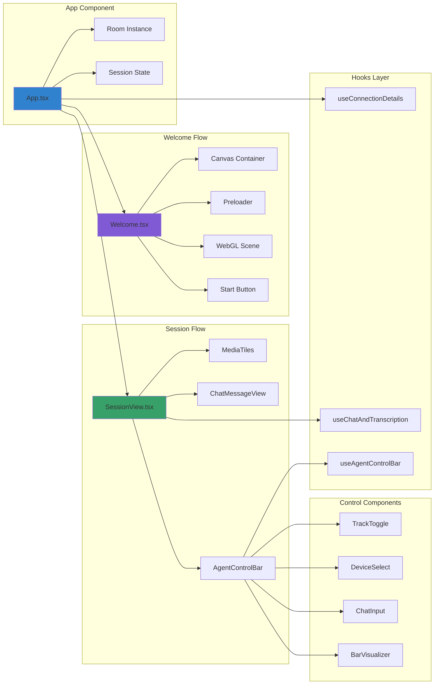
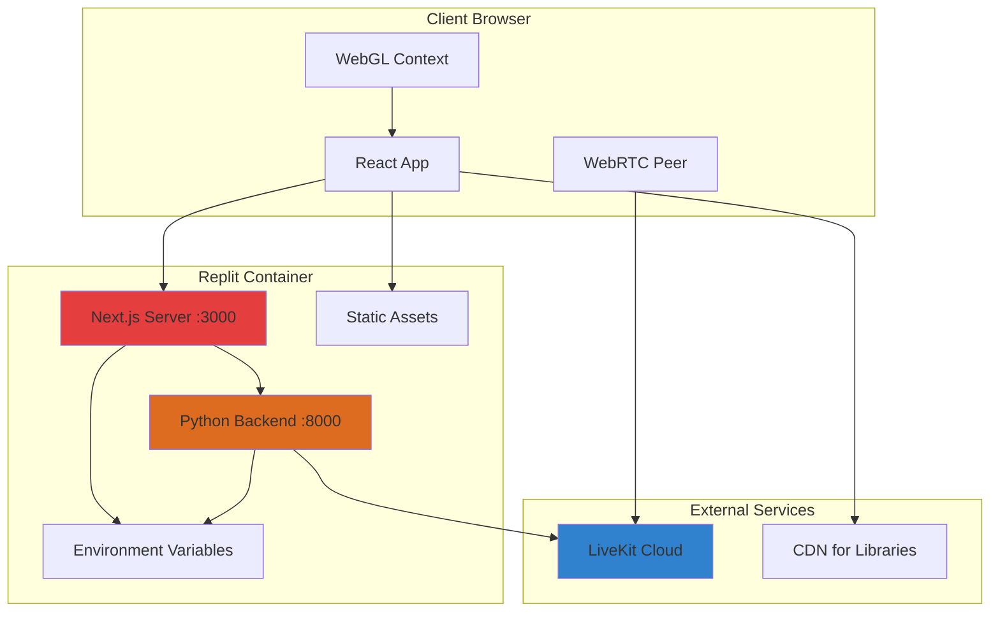

# Design Document: Alice UI Replit Redesign

## Overview

The Alice UI Replit Redesign project aims to optimize the existing Next.js-based voice assistant interface for deployment on the Replit platform. The current implementation features a sophisticated 3D WebGL welcome screen with a spectral ghost animation, real-time voice/video communication via LiveKit, and a comprehensive session management interface.

### Design Goals

1. **Replit Compatibility**: Ensure seamless deployment and operation within Replit's cloud environment
2. **Performance Optimization**: Minimize resource usage while maintaining visual quality and responsiveness
3. **Graceful Degradation**: Provide fallback experiences when WebGL or other advanced features are unavailable
4. **Developer Experience**: Maintain fast development iteration cycles with hot module replacement
5. **User Experience**: Preserve the engaging visual design and smooth interaction patterns

### Key Challenges

- **Resource Constraints**: Replit environments may have limited GPU/CPU resources compared to local development
- **WebGL Availability**: Not all Replit instances guarantee full WebGL 2.0 support
- **Bundle Size**: Large dependencies (Three.js, postprocessing) impact initial load time
- **State Management**: Complex interaction between welcome screen, session view, and LiveKit connection lifecycle
- **Real-time Communication**: Ensuring reliable WebRTC connections through Replit's network infrastructure

## Architecture

### High-Level System Architecture

```mermaid
graph TB
    subgraph "Client Layer"
        A[Next.js App Router]
        B[React 19 Components]
        C[Motion/Framer Motion]
    end
    
    subgraph "Presentation Layer"
        D[Welcome Screen]
        E[Session View]
        F[Settings Panel]
    end
    
    subgraph "Communication Layer"
        G[LiveKit Client SDK]
        H[WebRTC Engine]
        I[Data Channel]
    end
    
    subgraph "Rendering Layer"
        J[Three.js Scene]
        K[WebGL Renderer]
        L[Post-Processing]
    end
    
    subgraph "Backend Services"
        M[Connection API]
        N[LiveKit Server]
        O[Python Agent]
    end
    
    A --> B
    B --> D
    B --> E
    B --> F
    D --> J
    J --> K
    K --> L
    E --> G
    G --> H
    G --> I
    B --> C
    G --> N
    M --> N
    O --> N
    
    style D fill:#2d3748
    style E fill:#2d3748
    style J fill:#4a5568
    style G fill:#3182ce
```



### Component Architecture



### Deployment Architecture for Replit



## Components and Interfaces

### Core Components

#### 1. App Component (`components/app.tsx`)

**Purpose**: Root orchestrator managing application lifecycle, room connection, and view transitions.

**Key Responsibilities**:
- Initialize and manage LiveKit Room instance
- Handle session state transitions (welcome → session)
- Manage connection lifecycle and error handling
- Coordinate between Welcome and SessionView components

**Interface**:
```typescript
interface AppProps {
  appConfig: AppConfig;
}

interface AppConfig {
  companyName: string;
  pageTitle: string;
  pageDescription: string;
  supportsChatInput: boolean;
  supportsVideoInput: boolean;
  supportsScreenShare: boolean;
  isPreConnectBufferEnabled: boolean;
  logo: string;
  accent: string;
  logoDark: string;
  accentDark: string;
  startButtonText: string;
  agentName?: string;
}
```

**State Management**:
- `room`: LiveKit Room instance (memoized)
- `sessionStarted`: Boolean flag controlling view visibility
- Connection details from `useConnectionDetails` hook

**Event Handlers**:
- `onDisconnected`: Handles room disconnection, attempts reconnection for non-manual disconnects
- `onMediaDevicesError`: Displays toast notifications for device errors
- `onConnected`: Logs successful connection
- `onConnectionError`: Handles connection failures, resets session state

#### 2. Welcome Component (`components/welcome.tsx`)

**Purpose**: Engaging landing page with 3D WebGL ghost animation and start button.

**Key Responsibilities**:
- Initialize Three.js scene with WebGL renderer
- Manage preloader state and progress
- Handle mouse tracking for interactive ghost animation
- Provide graceful fallback when WebGL fails
- Trigger session start on button click

**Interface**:
```typescript
interface WelcomeProps {
  disabled: boolean;
  startButtonText: string;
  onStartCall: () => void;
}
```

**WebGL Scene Structure**:
- **Scene**: Three.js Scene with transparent background
- **Camera**: PerspectiveCamera (75° FOV, responsive aspect ratio)
- **Renderer**: WebGLRenderer with alpha transparency, high-performance settings
- **Post-Processing**: EffectComposer with BloomEffect for glow
- **Ghost**: Sphere geometry with custom wobble deformation
- **Eyes**: Sphere geometries with dynamic glow based on mouse movement
- **Atmosphere**: Shader-based fog effect that reveals around ghost position
- **Glitch Overlay**: Shader-based digital glitch effect

**Performance Optimizations**:
- Dynamic imports for Three.js and postprocessing libraries
- GPU acceleration hints (translateZ, backfaceVisibility)
- Efficient animation loop using requestAnimationFrame
- Proper resource disposal on unmount

**Fallback Strategy**:
- Catch WebGL initialization errors
- Display preloader completion even on failure
- Show start button without 3D effects
- Log errors to console for debugging

#### 3. SessionView Component (`components/session-view.tsx`)

**Purpose**: Active communication interface with media tiles, chat, and controls.

**Key Responsibilities**:
- Display remote participant video and screen shares
- Manage chat message view with transcriptions
- Coordinate control bar interactions
- Monitor agent availability and connection health
- Handle session timeout scenarios

**Interface**:
```typescript
interface SessionViewProps {
  appConfig: AppConfig;
  disabled: boolean;
  sessionStarted: boolean;
}
```

**Layout Structure**:
- **Top Gradient**: Visual separator with fade effect
- **MediaTiles**: Floating video/screen share displays
- **ChatMessageView**: Scrollable message container
- **ControlBar**: Fixed bottom toolbar
- **Bottom Gradient**: Visual separator with fade effect

**State Management**:
- `chatOpen`: Boolean controlling chat input visibility
- `messages`: Merged array of chat and transcription messages
- `agentState`: Current agent status from LiveKit

**Agent Health Monitoring**:
- 20-second timeout for agent join
- Automatic disconnect if agent doesn't initialize
- Toast notification with documentation link

#### 4. AgentControlBar Component (`components/livekit/agent-control-bar/agent-control-bar.tsx`)

**Purpose**: Unified control interface for microphone, camera, screen share, chat, and disconnect.

**Key Responsibilities**:
- Manage track toggles (mic, camera, screen share)
- Handle device selection dropdowns
- Control chat input visibility
- Provide disconnect functionality
- Display audio visualizer

**Interface**:
```typescript
interface AgentControlBarProps {
  capabilities: {
    supportsChatInput: boolean;
    supportsVideoInput: boolean;
    supportsScreenShare: boolean;
  };
  onChatOpenChange?: (open: boolean) => void;
  onSendMessage?: (message: string) => Promise<void>;
  onDisconnect?: () => void;
  onDeviceError?: (error: { source: Track.Source; error: Error }) => void;
}
```

**Control Elements**:
- **Microphone Toggle**: TrackToggle with BarVisualizer (3 bars)
- **Audio Device Select**: Dropdown for microphone selection
- **Camera Toggle**: TrackToggle for video
- **Video Device Select**: Dropdown for camera selection
- **Screen Share Toggle**: TrackToggle for screen capture
- **Chat Toggle**: Opens/closes chat input
- **Disconnect Button**: Ends session

**Responsive Behavior**:
- Hide device selects on mobile (< md breakpoint)
- Abbreviate button text on mobile ("END" vs "Say Bye")
- Adjust padding and spacing for small screens

#### 5. SettingsPanel Component (`components/settings-panel.tsx`)

**Purpose**: Customizable color configuration interface.

**Key Responsibilities**:
- Provide color pickers for UI elements
- Persist settings to localStorage
- Apply colors via CSS custom properties
- Offer preset color options
- Support reset to defaults

**Interface**:
```typescript
interface SettingsPanelProps {
  // Inherits standard div props
}

interface ColorSettings {
  visualizerColor: string;
  micColor: string;
  cameraColor: string;
  screenShareColor: string;
  chatColor: string;
  byeColor: string;
  inputBorderColor: string;
  textColor: string;
}
```

**CSS Custom Properties**:
```css
--alice-visualizer-color
--alice-mic-color
--alice-camera-color
--alice-screen-share-color
--alice-chat-color
--alice-bye-color
--alice-input-border-color
--alice-text-color
```

**Preset Colors**: cyan, orange, purple, green, pink, blue, white, red

### Custom Hooks

#### 1. useConnectionDetails Hook

**Purpose**: Manage LiveKit connection details fetching and refreshing.

**Interface**:
```typescript
interface ConnectionDetails {
  serverUrl: string;
  participantToken: string;
  participantName: string;
}

function useConnectionDetails(appConfig: AppConfig): {
  connectionDetails: ConnectionDetails | undefined;
  refreshConnectionDetails: () => Promise<ConnectionDetails>;
  existingOrRefreshConnectionDetails: () => Promise<ConnectionDetails>;
}
```

**Behavior**:
- Fetches connection details from `/api/connection-details`
- Includes sandbox ID in request headers
- Validates JWT token expiration
- Refreshes tokens within 1 minute of expiry
- Caches valid connection details

#### 2. useChatAndTranscription Hook

**Purpose**: Merge chat messages and voice transcriptions into unified view.

**Interface**:
```typescript
interface ReceivedChatMessage {
  id: string;
  message: string;
  from?: Participant;
  timestamp: number;
}

function useChatAndTranscription(): {
  messages: ReceivedChatMessage[];
  send: (message: string) => Promise<void>;
}
```

**Behavior**:
- Subscribes to LiveKit chat messages
- Subscribes to voice transcription events
- Merges both sources chronologically
- Formats transcriptions as chat messages
- Sends messages via LiveKit data channel

#### 3. useAgentControlBar Hook

**Purpose**: Manage control bar state and track toggle logic.

**Interface**:
```typescript
interface UseAgentControlBarProps {
  controls?: {
    microphone?: boolean;
    camera?: boolean;
    screenShare?: boolean;
    chat?: boolean;
    leave?: boolean;
  };
  saveUserChoices?: boolean;
}

function useAgentControlBar(props: UseAgentControlBarProps): {
  micTrackRef: TrackReferenceOrPlaceholder;
  visibleControls: Record<string, boolean>;
  cameraToggle: TrackToggleState;
  microphoneToggle: TrackToggleState;
  screenShareToggle: TrackToggleState;
  handleAudioDeviceChange: (deviceId: string) => Promise<void>;
  handleVideoDeviceChange: (deviceId: string) => Promise<void>;
  handleDisconnect: () => Promise<void>;
}
```

**Behavior**:
- Tracks enabled/pending state for each control
- Persists device choices to localStorage
- Handles track enable/disable operations
- Manages async toggle operations

## Data Models

### Connection Details Model

```typescript
interface ConnectionDetails {
  serverUrl: string;          // LiveKit server WebSocket URL
  participantToken: string;   // JWT token for authentication
  participantName: string;    // Display name for participant
}
```

**Token Structure** (JWT):
```json
{
  "exp": 1234567890,          // Expiration timestamp
  "iss": "livekit-server",    // Issuer
  "sub": "participant-id",    // Subject (participant ID)
  "video": {
    "room": "room-name",
    "roomJoin": true,
    "canPublish": true,
    "canSubscribe": true
  }
}
```

### Chat Message Model

```typescript
interface ReceivedChatMessage {
  id: string;                 // Unique message identifier
  message: string;            // Message content
  from?: Participant;         // Sender participant (optional for system messages)
  timestamp: number;          // Unix timestamp in milliseconds
}
```

### Transcription Model

```typescript
interface TranscriptionSegment {
  id: string;                 // Unique segment identifier
  text: string;               // Transcribed text
  participant: Participant;   // Speaker participant
  timestamp: number;          // Unix timestamp in milliseconds
  isFinal: boolean;           // Whether transcription is finalized
}
```

### Agent State Model

```typescript
type AgentState = 
  | 'disconnected'            // Not connected to room
  | 'connecting'              // Establishing connection
  | 'initializing'            // Agent joining room
  | 'listening'               // Agent ready to receive input
  | 'thinking'                // Agent processing input
  | 'speaking';               // Agent generating output
```

### Device Model

```typescript
interface MediaDeviceInfo {
  deviceId: string;           // Unique device identifier
  kind: 'audioinput' | 'videoinput' | 'audiooutput';
  label: string;              // Human-readable device name
  groupId: string;            // Device group identifier
}
```

### Settings Model

```typescript
interface ColorSettings {
  visualizerColor: string;    // Hex color for audio visualizer
  micColor: string;           // Hex color for microphone button
  cameraColor: string;        // Hex color for camera button
  screenShareColor: string;   // Hex color for screen share button
  chatColor: string;          // Hex color for chat button
  byeColor: string;           // Hex color for disconnect button
  inputBorderColor: string;   // Hex color for chat input border
  textColor: string;          // Hex color for text elements
}
```

**Storage**: Persisted to `localStorage` under key `alice-color-settings`

### Room State Model

```typescript
interface RoomState {
  state: 'disconnected' | 'connecting' | 'connected';
  participants: Map<string, RemoteParticipant>;
  localParticipant: LocalParticipant;
  activeSpeakers: Participant[];
  metadata?: string;
}
```

### Track Model

```typescript
interface Track {
  sid: string;                // Server-assigned track ID
  kind: 'audio' | 'video';
  source: 'camera' | 'microphone' | 'screen_share' | 'screen_share_audio';
  muted: boolean;
  enabled: boolean;
  dimensions?: { width: number; height: number };
}
```

## Error Handling

### Error Categories

#### 1. Connection Errors

**Scenarios**:
- Failed to fetch connection details from API
- Invalid or expired JWT token
- WebSocket connection timeout
- Network connectivity issues
- LiveKit server unavailable

**Handling Strategy**:
```typescript
try {
  const details = await fetchConnectionDetails();
  await room.connect(details.serverUrl, details.participantToken);
} catch (error) {
  // Display user-friendly error message
  toastAlert({
    title: 'Connection Failed',
    description: `Unable to connect: ${error.message}`,
  });
  
  // Reset session state
  setSessionStarted(false);
  
  // Log for debugging
  console.error('Connection error:', error);
}
```

**Retry Logic**:
- Automatic reconnection for non-manual disconnects
- Exponential backoff (max 3 retries, 1000ms delay)
- 3-second delay before refreshing connection details
- 10-second connection timeout

#### 2. Media Device Errors

**Scenarios**:
- Permission denied for microphone/camera
- Device not found or unavailable
- Device in use by another application
- Hardware failure

**Handling Strategy**:
```typescript
room.on(RoomEvent.MediaDevicesError, (error: Error) => {
  toastAlert({
    title: 'Media Device Error',
    description: `${error.name}: ${error.message}`,
  });
  
  // Provide recovery suggestions
  if (error.name === 'NotAllowedError') {
    // Suggest checking browser permissions
  } else if (error.name === 'NotFoundError') {
    // Suggest checking device connections
  }
});
```

**Device Selection Error Callback**:
```typescript
onDeviceError={(error) => {
  console.error(`Device error (${error.source}):`, error.error);
  toastAlert({
    title: `${error.source} Error`,
    description: error.error.message,
  });
}}
```

#### 3. WebGL Initialization Errors

**Scenarios**:
- WebGL not supported by browser
- GPU blacklisted or disabled
- Insufficient GPU memory
- Context creation failure

**Handling Strategy**:
```typescript
try {
  // Initialize Three.js scene
  const renderer = new THREE.WebGLRenderer({ ... });
  // ... scene setup
} catch (error) {
  console.error('WebGL initialization failed:', error);
  
  // Graceful degradation
  setIsLoaded(true);  // Show content without 3D
  
  // Complete preloader
  if (preloaderRef.current) {
    preloaderRef.current.classList.add('fade-out');
  }
  if (contentRef.current) {
    contentRef.current.classList.add('fade-in');
  }
}
```

**Fallback Experience**:
- Display welcome content without 3D animation
- Show start button immediately
- Maintain full functionality for session

#### 4. Agent Availability Errors

**Scenarios**:
- Agent fails to join room within timeout
- Agent disconnects unexpectedly
- Agent initialization incomplete

**Handling Strategy**:
```typescript
useEffect(() => {
  if (sessionStarted) {
    const timeout = setTimeout(() => {
      if (!isAgentAvailable(agentState)) {
        const reason = agentState === 'connecting'
          ? 'Agent did not join the room.'
          : 'Agent connected but did not complete initializing.';
        
        toastAlert({
          title: 'Session ended',
          description: (
            <p>
              {reason}
              <a href="https://docs.livekit.io/agents/start/voice-ai/">
                See quickstart guide
              </a>
            </p>
          ),
        });
        
        room.disconnect();
      }
    }, 20_000);  // 20-second timeout
    
    return () => clearTimeout(timeout);
  }
}, [agentState, sessionStarted, room]);
```

#### 5. Chat and Messaging Errors

**Scenarios**:
- Message send failure (data channel closed)
- Message too large
- Rate limiting

**Handling Strategy**:
```typescript
async function handleSendMessage(message: string) {
  setIsSendingMessage(true);
  try {
    await send(message);
  } catch (error) {
    toastAlert({
      title: 'Message Failed',
      description: 'Unable to send message. Please try again.',
    });
    console.error('Message send error:', error);
  } finally {
    setIsSendingMessage(false);
  }
}
```

### Error Boundaries

**React Error Boundary**:
```typescript
class ErrorBoundary extends React.Component {
  componentDidCatch(error: Error, errorInfo: React.ErrorInfo) {
    console.error('React error boundary caught:', error, errorInfo);
    
    // Log to error tracking service (if configured)
    // reportError(error, errorInfo);
    
    // Display fallback UI
    this.setState({ hasError: true });
  }
  
  render() {
    if (this.state.hasError) {
      return <ErrorFallback />;
    }
    return this.props.children;
  }
}
```

### User Feedback Patterns

**Toast Notifications**:
- **Error**: Red background, error icon, descriptive message
- **Warning**: Yellow background, warning icon, actionable message
- **Success**: Green background, success icon, confirmation message
- **Info**: Blue background, info icon, informational message

**Loading States**:
- Disabled buttons during async operations
- Spinner or progress indicators
- Skeleton screens for content loading
- Preloader for initial scene initialization

**Visual Feedback**:
- Button hover/focus states
- Disabled state styling
- Pending operation indicators
- Connection status indicators

## Testing Strategy

### Unit Testing

**Focus Areas**:
- Component rendering with various prop combinations
- Hook behavior and state management
- Utility function correctness
- Error handling logic

**Testing Framework**: Jest + React Testing Library

**Example Tests**:
```typescript
describe('Welcome Component', () => {
  it('should render start button after loading', async () => {
    render(<Welcome startButtonText="Start" onStartCall={jest.fn()} disabled={false} />);
    await waitFor(() => expect(screen.getByText('Start')).toBeInTheDocument());
  });
  
  it('should call onStartCall when button clicked', () => {
    const onStartCall = jest.fn();
    render(<Welcome startButtonText="Start" onStartCall={onStartCall} disabled={false} />);
    fireEvent.click(screen.getByText('Start'));
    expect(onStartCall).toHaveBeenCalledTimes(1);
  });
  
  it('should handle WebGL initialization failure gracefully', async () => {
    // Mock WebGL failure
    jest.spyOn(console, 'error').mockImplementation();
    // ... test fallback behavior
  });
});

describe('useConnectionDetails Hook', () => {
  it('should fetch connection details on mount', async () => {
    const { result } = renderHook(() => useConnectionDetails(mockConfig));
    await waitFor(() => expect(result.current.connectionDetails).toBeDefined());
  });
  
  it('should refresh expired tokens', async () => {
    // Mock expired token
    // ... test refresh logic
  });
});
```

### Integration Testing

**Focus Areas**:
- Welcome to session transition flow
- LiveKit room connection lifecycle
- Chat and transcription integration
- Device selection and track management
- Settings persistence and application

**Testing Approach**:
- Use LiveKit test utilities for room simulation
- Mock WebRTC APIs
- Test component interactions
- Verify state synchronization

**Example Tests**:
```typescript
describe('Session Flow Integration', () => {
  it('should transition from welcome to session on start', async () => {
    render(<App appConfig={mockConfig} />);
    
    // Wait for welcome screen
    await waitFor(() => expect(screen.getByText('START UI')).toBeInTheDocument());
    
    // Click start button
    fireEvent.click(screen.getByText('START UI'));
    
    // Verify session view appears
    await waitFor(() => expect(screen.getByLabelText('Voice assistant controls')).toBeInTheDocument());
  });
  
  it('should handle connection failure and allow retry', async () => {
    // Mock connection failure
    // ... test error handling and retry
  });
});
```

### End-to-End Testing

**Focus Areas**:
- Complete user journey (welcome → session → disconnect)
- Real LiveKit connection (test environment)
- WebGL rendering verification
- Cross-browser compatibility
- Responsive design validation

**Testing Framework**: Playwright or Cypress

**Example Tests**:
```typescript
test('complete voice assistant session', async ({ page }) => {
  await page.goto('/');
  
  // Wait for welcome screen to load
  await page.waitForSelector('text=START UI');
  
  // Grant media permissions
  await page.context().grantPermissions(['microphone', 'camera']);
  
  // Start session
  await page.click('text=START UI');
  
  // Verify session view
  await page.waitForSelector('[aria-label="Voice assistant controls"]');
  
  // Test microphone toggle
  await page.click('[aria-label="Toggle microphone"]');
  
  // Test chat
  await page.click('[aria-label="Toggle chat"]');
  await page.fill('input[placeholder="Type a message"]', 'Hello Alice');
  await page.press('input[placeholder="Type a message"]', 'Enter');
  
  // Disconnect
  await page.click('text=Say Bye');
  
  // Verify return to welcome
  await page.waitForSelector('text=START UI');
});
```

### Visual Regression Testing

**Focus Areas**:
- Welcome screen appearance
- Session view layout
- Control bar styling
- Settings panel UI
- Responsive breakpoints

**Testing Approach**:
- Capture screenshots at key states
- Compare against baseline images
- Test across different viewports
- Verify theme customization

### Performance Testing

**Focus Areas**:
- Initial bundle size
- Time to interactive
- WebGL frame rate
- Memory usage over time
- Network request optimization

**Metrics**:
- **Bundle Size**: < 500KB initial (gzipped)
- **Time to Interactive**: < 3 seconds
- **Frame Rate**: 60 FPS for WebGL animation
- **Memory**: No leaks over 5-minute session
- **Connection Time**: < 2 seconds to LiveKit

**Testing Tools**:
- Lighthouse for performance audits
- Chrome DevTools for profiling
- Bundle analyzer for size optimization
- Memory profiler for leak detection

### Accessibility Testing

**Focus Areas**:
- Keyboard navigation
- Screen reader compatibility
- ARIA labels and roles
- Focus management
- Color contrast

**Testing Approach**:
- Automated testing with axe-core
- Manual testing with screen readers (NVDA, JAWS, VoiceOver)
- Keyboard-only navigation testing
- Color contrast verification

**WCAG Compliance Target**: Level AA

**Note**: Full WCAG validation requires manual testing with assistive technologies and expert accessibility review.

### Replit-Specific Testing

**Focus Areas**:
- Deployment on Replit environment
- Environment variable configuration
- Resource constraint handling
- WebGL availability detection
- Network connectivity through Replit proxy

**Testing Checklist**:
- [ ] Deploy to Replit and verify startup
- [ ] Test with limited GPU resources
- [ ] Verify environment variable loading
- [ ] Test WebGL fallback on constrained instances
- [ ] Verify LiveKit connection through Replit network
- [ ] Test hot module replacement
- [ ] Verify concurrent frontend/backend execution
- [ ] Test HTTPS certificate handling

## Deployment and Configuration

### Environment Variables

**Required Variables**:
```bash
# LiveKit Configuration
LIVEKIT_API_KEY=your_api_key
LIVEKIT_API_SECRET=your_api_secret
LIVEKIT_URL=wss://your-livekit-server.com

# Application Configuration
NEXT_PUBLIC_APP_NAME=Alice
NEXT_PUBLIC_SANDBOX_ID=optional_sandbox_id

# Development
NODE_ENV=development|production
```

**Configuration File** (`.env.local`):
```bash
LIVEKIT_API_KEY=devkey
LIVEKIT_API_SECRET=secret
LIVEKIT_URL=ws://localhost:7880
NEXT_PUBLIC_APP_NAME=Alice
```

### Replit Configuration

**`.replit` File**:
```toml
run = "pnpm dev"
entrypoint = "ALICE/agent-starter-react/package.json"

[nix]
channel = "stable-22_11"

[deployment]
run = ["pnpm", "build", "&&", "pnpm", "start"]
deploymentTarget = "cloudrun"

[[ports]]
localPort = 3000
externalPort = 80
```

**`replit.nix` File**:
```nix
{ pkgs }: {
  deps = [
    pkgs.nodejs-18_x
    pkgs.python310
    pkgs.python310Packages.pip
  ];
}
```

### Build Configuration

**Next.js Configuration** (`next.config.ts`):
```typescript
import type { NextConfig } from 'next';

const nextConfig: NextConfig = {
  reactStrictMode: true,
  
  // Enable Turbopack for faster development
  experimental: {
    turbo: {
      rules: {
        '*.svg': {
          loaders: ['@svgr/webpack'],
          as: '*.js',
        },
      },
    },
  },
  
  // Optimize for production
  compiler: {
    removeConsole: process.env.NODE_ENV === 'production',
  },
  
  // Configure headers for CORS
  async headers() {
    return [
      {
        source: '/api/:path*',
        headers: [
          { key: 'Access-Control-Allow-Origin', value: '*' },
          { key: 'Access-Control-Allow-Methods', value: 'GET,POST,OPTIONS' },
        ],
      },
    ];
  },
};

export default nextConfig;
```

**TypeScript Configuration** (`tsconfig.json`):
```json
{
  "compilerOptions": {
    "target": "ES2020",
    "lib": ["dom", "dom.iterable", "esnext"],
    "allowJs": true,
    "skipLibCheck": true,
    "strict": true,
    "forceConsistentCasingInFileNames": true,
    "noEmit": true,
    "esModuleInterop": true,
    "module": "esnext",
    "moduleResolution": "bundler",
    "resolveJsonModule": true,
    "isolatedModules": true,
    "jsx": "preserve",
    "incremental": true,
    "plugins": [{ "name": "next" }],
    "paths": {
      "@/*": ["./*"]
    }
  },
  "include": ["next-env.d.ts", "**/*.ts", "**/*.tsx", ".next/types/**/*.ts"],
  "exclude": ["node_modules"]
}
```

### Deployment Steps for Replit

1. **Initial Setup**:
   ```bash
   # Fork or import repository to Replit
   # Install dependencies
   pnpm install
   ```

2. **Configure Environment**:
   - Add environment variables in Replit Secrets
   - Set `LIVEKIT_API_KEY`, `LIVEKIT_API_SECRET`, `LIVEKIT_URL`

3. **Start Development**:
   ```bash
   pnpm dev
   ```
   - Frontend runs on port 3000
   - Backend runs on port 8000 (Python agent)

4. **Production Build**:
   ```bash
   pnpm build
   pnpm start
   ```

5. **Verify Deployment**:
   - Test welcome screen loads
   - Verify WebGL animation (or fallback)
   - Test LiveKit connection
   - Verify media device access
   - Test chat and transcription

### Performance Optimization for Replit

**Bundle Size Reduction**:
- Dynamic imports for Three.js libraries
- Code splitting for routes
- Tree shaking for unused exports
- Minification and compression

**Runtime Optimization**:
- Memoization of expensive computations
- Efficient re-render prevention
- Lazy loading of non-critical components
- Resource cleanup on unmount

**Network Optimization**:
- CDN for static assets
- Efficient API request batching
- WebSocket connection reuse
- Compression for data transfer

**WebGL Optimization**:
- Reduced geometry complexity
- Efficient shader compilation
- Texture optimization
- Frame rate throttling on low-end devices

## Conclusion

This design document provides a comprehensive blueprint for the Alice UI Replit Redesign project. The architecture balances visual sophistication with performance constraints, ensuring a smooth user experience across various deployment environments.

### Key Design Decisions

1. **Graceful Degradation**: WebGL failures don't prevent core functionality
2. **Modular Architecture**: Clear separation of concerns enables maintainability
3. **Performance First**: Dynamic imports and optimization strategies minimize resource usage
4. **User-Centric Error Handling**: Clear feedback and recovery paths for all error scenarios
5. **Flexible Configuration**: Environment-based settings support various deployment targets

### Next Steps

1. Review and approve this design document
2. Proceed to task breakdown and implementation planning
3. Set up Replit development environment
4. Implement core components with testing
5. Deploy and validate on Replit platform

### Open Questions for Review

1. Should we implement additional WebGL quality presets for different performance tiers?
2. Do we need offline support or service worker caching?
3. Should we add analytics/telemetry for monitoring user experience?
4. Are there specific Replit resource limits we should design around?
5. Should we implement A/B testing for different welcome screen variants?
