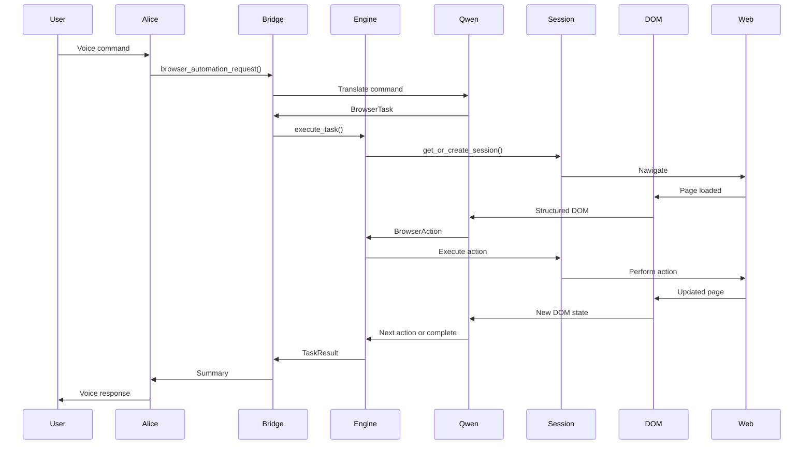

# Alice Browser Automation - Developer Guide

## Overview

This guide provides comprehensive information for developers who want to extend, customize, or integrate Alice Browser Automation into their own projects.

**Version:** 1.0.0  
**Requirements Coverage:** All requirements (1.1-12.6)

---

## Table of Contents

1. [Architecture Overview](#architecture-overview)
2. [Component Interactions](#component-interactions)
3. [Adding New Action Suites](#adding-new-action-suites)
4. [Adding New Applications](#adding-new-applications)
5. [Extension Points](#extension-points)
6. [Testing](#testing)
7. [Contributing](#contributing)

---

## Architecture Overview

### System Architecture

Alice Browser Automation follows a layered architecture:

```
┌─────────────────────────────────────────────────────────────┐
│                     Alice Voice Layer                        │
│  (LiveKit Voice Agent + Gemini for Conversation)            │
└────────────────────┬────────────────────────────────────────┘
                     │
┌────────────────────▼────────────────────────────────────────┐
│                   Bridge Layer                               │
│  (LiveKit-Qwen Bridge, Function Call Interface)            │
└────────────────────┬────────────────────────────────────────┘
                     │
┌────────────────────▼────────────────────────────────────────┐
│                 Automation Layer                             │
│  (Browser Automation Engine, Action Suites)                 │
└────────────────────┬────────────────────────────────────────┘
                     │
┌────────────────────▼────────────────────────────────────────┐
│                Processing Layer                              │
│  (Qwen Model Client, DOM Parser, Prompt Builder)           │
└────────────────────┬────────────────────────────────────────┘
                     │
┌────────────────────▼────────────────────────────────────────┐
│                  Browser Layer                               │
│  (Playwright, Session Manager, Profile Manager)            │
└─────────────────────────────────────────────────────────────┘
```

### Key Design Principles

1. **DOM-First Approach**
   - Extract structured DOM instead of screenshots
   - Use accessibility tree for accurate element identification
   - Eliminates hallucination from vision-based approaches

2. **Local Processing**
   - Qwen 3B model runs locally via Ollama
   - Privacy-preserving (no data sent to external APIs)
   - Low latency for action generation

3. **Persistent Sessions**
   - Chrome profiles maintain authentication across restarts
   - Session reuse for same domain
   - Automatic idle session cleanup

4. **Graceful Degradation**
   - Multiple selector strategies (CSS, XPath, ARIA)
   - Automatic retry with alternative selectors
   - Crash recovery and session restart

5. **Security First**
   - Payment confirmation required
   - Sensitive data filtering in logs
   - Encrypted credential storage
   - SSL validation

---

## Component Interactions

### Data Flow



### Component Responsibilities

| Component | Responsibility | Key Methods |
|-----------|---------------|-------------|
| **BrowserAutomationEngine** | Orchestrate tasks | `execute_task()`, `initialize()`, `shutdown()` |
| **SessionManager** | Manage browser sessions | `create_session()`, `close_idle_sessions()` |
| **DOMParser** | Extract DOM structure | `parse_page()`, `get_accessibility_tree()` |
| **LiveKitQwenBridge** | Connect voice to Qwen | `translate_voice_command()`, `generate_action_plan()` |
| **QwenModelClient** | Interface with Ollama | `generate_with_prompt()`, `generate_json_response()` |
| **ChromeProfileManager** | Manage profiles | `get_or_create_profile()`, `encrypt_credentials()` |
| **ErrorHandler** | Handle errors | `handle_error()`, `retry_with_fallback()` |
| **SecurityManager** | Enforce security | `validate_url()`, `require_payment_confirmation()` |

---

## Adding New Action Suites

Action Suites are collections of related browser automation capabilities. Here's how to create a new one.

### Step 1: Create Action Suite Class

```python
# my_action_suite.py

import logging
from typing import Dict, Any, Optional, Callable
from datetime import datetime

from alice_browser_automation.types import (
    BrowserTask, TaskResult, TaskType
)
from alice_browser_automation.exceptions import BrowserAutomationError

logger = logging.getLogger(__name__)


class MyActionSuite:
    """
    My custom action suite for specific automation tasks.
    
    Requirements: [List relevant requirements]
    """
    
    def __init__(
        self,
        engine: Any,  # BrowserAutomationEngine
        config: Optional[Dict[str, Any]] = None
    ):
        """
        Initialize the action suite.
        
        Args:
            engine: BrowserAutomationEngine instance
            config: Optional configuration dictionary
        """
        self.engine = engine
        self.config = config or {}
        
        # Initialize any suite-specific settings
        self.default_settings = self.config.get("my_settings", {})
        
        logger.info("MyActionSuite initialized")
    
    async def my_automation_task(
        self,
        param1: str,
        param2: int,
        progress_callback: Optional[Callable[[str], None]] = None
    ) -> TaskResult:
        """
        Perform a specific automation task.
        
        Args:
            param1: Description of parameter 1
            param2: Description of parameter 2
            progress_callback: Optional progress callback
        
        Returns:
            TaskResult with task execution results
        
        Requirements: [List requirements this method validates]
        """
        logger.info(f"Starting my_automation_task: {param1}")
        
        try:
            # Report progress
            if progress_callback:
                progress_callback("Starting task...")
            
            # Create browser task
            task = BrowserTask(
                task_id=f"my_task_{datetime.now().timestamp()}",
                description=f"My automation task: {param1}",
                task_type=TaskType.WEB_BOOKING,  # Or appropriate type
                parameters={
                    "param1": param1,
                    "param2": param2
                },
                target_url="https://example.com",
                expected_outcome="Task completed successfully"
            )
            
            # Execute through engine
            result = await self.engine.execute_task(
                task_description=task.description,
                task_type=task.task_type,
                parameters=task.parameters,
                target_url=task.target_url,
                progress_callback=progress_callback
            )
            
            logger.info(f"Task completed: {result.success}")
            return result
            
        except Exception as e:
            logger.error(f"Task failed: {e}")
            return TaskResult(
                task_id=f"my_task_{datetime.now().timestamp()}",
                success=False,
                summary=f"Task failed: {str(e)}",
                actions_taken=[],
                extracted_data={},
                error=str(e),
                duration_seconds=0.0
            )
```

### Step 2: Register with Engine

```python
# In engine.py __init__ or initialize()

from .my_action_suite import MyActionSuite

# In initialize() method:
self.my_action_suite = MyActionSuite(
    engine=self,
    config=self.config.to_dict().get("my_action_suite", {})
)
logger.info("✓ My Action Suite initialized")
```

### Step 3: Add Configuration Support

```yaml
# In config file
my_action_suite:
  my_settings:
    setting1: value1
    setting2: value2
  default_url: "https://example.com"
```

### Step 4: Add Tests

```python
# test_my_action_suite.py

import pytest
from alice_browser_automation.my_action_suite import MyActionSuite

@pytest.mark.asyncio
async def test_my_automation_task(mock_engine):
    """Test my automation task."""
    suite = MyActionSuite(engine=mock_engine)
    
    result = await suite.my_automation_task(
        param1="test",
        param2=42
    )
    
    assert result.success
    assert "test" in result.summary
```

### Step 5: Document

Add documentation to:
- API Reference (method signatures)
- User Guide (voice command examples)
- Developer Guide (architecture notes)

---

## Adding New Applications

To add support for a new web application:

### Step 1: Create Application Configuration

```python
# In app_access.py or separate config file

from alice_browser_automation.app_access import AppConfig, AppType

MY_APP_CONFIG = AppConfig(
    app_name="MyApp",
    app_type=AppType.PRODUCTIVITY,
    url="https://myapp.com",
    login_url="https://myapp.com/login",
    profile_name="myapp_profile",
    
    # Authentication selectors
    username_selector="input[name='username']",
    password_selector="input[name='password']",
    login_button_selector="button[type='submit']",
    
    # Session detection
    logged_in_indicator="div.user-menu",
    logged_out_indicator="a.login-link",
    
    # Navigation sections
    sections={
        "dashboard": "https://myapp.com/dashboard",
        "settings": "https://myapp.com/settings",
        "reports": "https://myapp.com/reports"
    },
    
    # Metadata
    requires_2fa=False,
    session_timeout_minutes=60
)
```

### Step 2: Register Configuration

```python
# In ApplicationAccessActionSuite.__init__()

self.app_configs["myapp"] = MY_APP_CONFIG
```

### Step 3: Test Authentication

```python
# test_myapp_access.py

@pytest.mark.asyncio
async def test_myapp_authentication(app_access_suite, mock_session):
    """Test MyApp authentication."""
    config = app_access_suite.get_app_config("myapp")
    
    # Test authentication check
    is_authenticated = await app_access_suite.check_authentication(
        app_config=config,
        session=mock_session
    )
    
    assert isinstance(is_authenticated, bool)
```

### Step 4: Add Voice Commands

Users can now use:
```
"Alice, open MyApp dashboard"
"Alice, check MyApp settings"
"Alice, navigate to MyApp reports"
```

### Step 5: Document

Add to User Guide:
```markdown
### MyApp

**Sections:** Dashboard, Settings, Reports

**Voice commands:**
- "Open MyApp dashboard"
- "Check MyApp settings"
- "Show MyApp reports"
```

---

## Extension Points

### Custom DOM Parsers

Create custom DOM parsers for specific websites:

```python
from alice_browser_automation.dom_parser import DOMParser

class CustomDOMParser(DOMParser):
    """Custom DOM parser for specific website."""
    
    async def parse_page(self, page):
        """Override to add custom parsing logic."""
        # Call parent implementation
        dom = await super().parse_page(page)
        
        # Add custom processing
        dom.metadata["custom_field"] = await self._extract_custom_data(page)
        
        return dom
    
    async def _extract_custom_data(self, page):
        """Extract custom data from page."""
        # Your custom extraction logic
        return await page.evaluate("() => document.customData")
```

### Custom Error Handlers

Add custom error handling logic:

```python
from alice_browser_automation.error_handler import ErrorHandler

class CustomErrorHandler(ErrorHandler):
    """Custom error handler with additional recovery strategies."""
    
    async def handle_error(self, error, context):
        """Override to add custom error handling."""
        # Try custom recovery first
        if await self._custom_recovery(error, context):
            return True
        
        # Fall back to default handling
        return await super().handle_error(error, context)
    
    async def _custom_recovery(self, error, context):
        """Custom error recovery logic."""
        # Your custom recovery logic
        return False
```

### Custom Prompt Templates

Customize prompts for Qwen model:

```python
from alice_browser_automation.qwen_client import QwenModelClient

class CustomQwenClient(QwenModelClient):
    """Custom Qwen client with specialized prompts."""
    
    def _build_system_prompt(self):
        """Override to customize system prompt."""
        return """
        You are a specialized browser automation assistant for [specific domain].
        
        Your responses must be valid JSON following this schema:
        {
          "action_type": "navigate|click|type|wait|extract",
          "target_selector": {...},
          "parameters": {...}
        }
        
        Special rules for [specific domain]:
        1. [Custom rule 1]
        2. [Custom rule 2]
        """
```

### Custom Security Policies

Implement custom security policies:

```python
from alice_browser_automation.security import SecurityManager

class CustomSecurityManager(SecurityManager):
    """Custom security manager with additional policies."""
    
    def validate_url(self, url):
        """Override to add custom URL validation."""
        # Call parent validation
        if not super().validate_url(url):
            return False
        
        # Add custom validation
        if "restricted-domain.com" in url:
            logger.warning(f"Blocked restricted domain: {url}")
            return False
        
        return True
```

### Plugin System

Create a plugin system for third-party extensions:

```python
# plugin_interface.py

from abc import ABC, abstractmethod

class BrowserAutomationPlugin(ABC):
    """Base class for browser automation plugins."""
    
    @abstractmethod
    def get_name(self) -> str:
        """Return plugin name."""
        pass
    
    @abstractmethod
    async def initialize(self, engine):
        """Initialize plugin with engine instance."""
        pass
    
    @abstractmethod
    async def on_task_start(self, task):
        """Called when task starts."""
        pass
    
    @abstractmethod
    async def on_task_complete(self, task, result):
        """Called when task completes."""
        pass


# Example plugin
class LoggingPlugin(BrowserAutomationPlugin):
    """Plugin that logs all tasks."""
    
    def get_name(self):
        return "logging_plugin"
    
    async def initialize(self, engine):
        self.engine = engine
        logger.info("Logging plugin initialized")
    
    async def on_task_start(self, task):
        logger.info(f"Task started: {task.task_id}")
    
    async def on_task_complete(self, task, result):
        logger.info(f"Task completed: {task.task_id}, success={result.success}")


# Register plugin in engine
engine.register_plugin(LoggingPlugin())
```

---

## Testing

### Unit Tests

Test individual components in isolation:

```python
# test_dom_parser.py

import pytest
from alice_browser_automation.dom_parser import DOMParser

@pytest.mark.asyncio
async def test_parse_page(mock_page):
    """Test DOM parsing."""
    parser = DOMParser()
    
    # Mock page content
    mock_page.url = "https://example.com"
    mock_page.title = "Example Page"
    
    # Parse page
    dom = await parser.parse_page(mock_page)
    
    # Assertions
    assert dom.url == "https://example.com"
    assert dom.title == "Example Page"
    assert isinstance(dom.interactive_elements, list)
```

### Integration Tests

Test component interactions:

```python
# test_integration.py

@pytest.mark.asyncio
async def test_full_booking_flow(engine):
    """Test complete booking flow."""
    result = await engine.execute_task(
        task_description="Book a test flight",
        task_type=TaskType.WEB_BOOKING,
        parameters={
            "booking_type": "flight",
            "destination": "Test City",
            "departure_date": "2024-12-25"
        }
    )
    
    assert result.success
    assert "confirmation" in result.extracted_data
```

### Property-Based Tests

Test properties that should always hold:

```python
# test_properties.py

from hypothesis import given, strategies as st

@given(st.text(min_size=1), st.integers(min_value=1, max_value=10))
def test_task_id_uniqueness(description, count):
    """Test that task IDs are always unique."""
    task_ids = set()
    
    for _ in range(count):
        task = BrowserTask(
            task_id=generate_task_id(),
            description=description,
            task_type=TaskType.WEB_BOOKING,
            parameters={}
        )
        task_ids.add(task.task_id)
    
    assert len(task_ids) == count
```

### End-to-End Tests

Test complete user workflows:

```python
# test_e2e.py

@pytest.mark.e2e
@pytest.mark.asyncio
async def test_voice_to_booking(alice_agent, engine):
    """Test complete voice-to-booking workflow."""
    # Simulate voice command
    voice_command = "Book a flight to Paris on December 25th"
    
    # Process through Alice
    response = await alice_agent.process_command(voice_command)
    
    # Verify booking completed
    assert "booked" in response.lower()
    assert "confirmation" in response.lower()
```

### Test Fixtures

Create reusable test fixtures:

```python
# conftest.py

import pytest
from alice_browser_automation import BrowserAutomationEngine, Config

@pytest.fixture
async def engine():
    """Create test engine."""
    config = Config.load("test_config.yaml")
    engine = BrowserAutomationEngine(config)
    await engine.initialize()
    
    yield engine
    
    await engine.shutdown()

@pytest.fixture
def mock_page():
    """Create mock Playwright page."""
    class MockPage:
        url = "https://example.com"
        title = "Example"
        
        async def goto(self, url):
            self.url = url
        
        async def query_selector(self, selector):
            return MockElement()
    
    return MockPage()
```

### Running Tests

```bash
# Run all tests
pytest

# Run specific test file
pytest test_dom_parser.py

# Run with coverage
pytest --cov=alice_browser_automation

# Run only unit tests
pytest -m "not e2e"

# Run only integration tests
pytest -m integration

# Run with verbose output
pytest -v
```

---

## Contributing

### Development Setup

1. **Clone repository:**
   ```bash
   git clone https://github.com/your-org/alice-browser-automation.git
   cd alice-browser-automation
   ```

2. **Create virtual environment:**
   ```bash
   python -m venv .venv
   source .venv/bin/activate  # On Windows: .venv\Scripts\activate
   ```

3. **Install dependencies:**
   ```bash
   pip install -e ".[dev]"
   ```

4. **Install pre-commit hooks:**
   ```bash
   pre-commit install
   ```

### Code Style

Follow PEP 8 with these additions:

- **Line length:** 100 characters
- **Docstrings:** Google style
- **Type hints:** Required for all public methods
- **Imports:** Organized with `isort`
- **Formatting:** Use `black`

```python
def my_function(param1: str, param2: int) -> bool:
    """
    Short description of function.
    
    Longer description if needed.
    
    Args:
        param1: Description of param1
        param2: Description of param2
    
    Returns:
        Description of return value
    
    Raises:
        ValueError: When param1 is empty
    
    Example:
        >>> my_function("test", 42)
        True
    """
    if not param1:
        raise ValueError("param1 cannot be empty")
    
    return len(param1) > param2
```

### Commit Messages

Follow conventional commits:

```
type(scope): subject

body

footer
```

**Types:**
- `feat`: New feature
- `fix`: Bug fix
- `docs`: Documentation
- `style`: Formatting
- `refactor`: Code restructuring
- `test`: Tests
- `chore`: Maintenance

**Examples:**
```
feat(web-bookings): add support for car rentals

Implemented car rental booking functionality with support for
vehicle type selection and insurance options.

Closes #123
```

```
fix(session-manager): prevent memory leak in idle cleanup

Fixed issue where closed sessions were not properly removed from
tracking dictionary, causing memory leak over time.

Fixes #456
```

### Pull Request Process

1. **Create feature branch:**
   ```bash
   git checkout -b feature/my-feature
   ```

2. **Make changes and commit:**
   ```bash
   git add .
   git commit -m "feat(scope): description"
   ```

3. **Run tests:**
   ```bash
   pytest
   black .
   isort .
   mypy alice_browser_automation
   ```

4. **Push and create PR:**
   ```bash
   git push origin feature/my-feature
   ```

5. **PR checklist:**
   - [ ] Tests pass
   - [ ] Code formatted
   - [ ] Documentation updated
   - [ ] Changelog updated
   - [ ] Requirements validated

### Documentation

Update documentation when:
- Adding new features
- Changing APIs
- Fixing bugs that affect usage
- Adding examples

**Documentation files:**
- `API_REFERENCE.md`: API documentation
- `USER_GUIDE.md`: User-facing documentation
- `DEVELOPER_GUIDE.md`: This file
- `README.md`: Project overview
- Docstrings: In-code documentation

### Release Process

1. **Update version:**
   ```python
   # In __init__.py
   __version__ = "1.1.0"
   ```

2. **Update changelog:**
   ```markdown
   ## [1.1.0] - 2024-XX-XX
   
   ### Added
   - New feature X
   
   ### Fixed
   - Bug Y
   
   ### Changed
   - Behavior Z
   ```

3. **Create release:**
   ```bash
   git tag v1.1.0
   git push origin v1.1.0
   ```

4. **Build and publish:**
   ```bash
   python -m build
   twine upload dist/*
   ```

---

## Advanced Topics

### Performance Optimization

**Session Pooling:**
```python
# Maintain warm session pool for faster startup
class OptimizedSessionManager(SessionManager):
    async def initialize(self):
        await super().initialize()
        # Pre-create warm sessions
        await self._create_session_pool(size=2)
```

**DOM Caching:**
```python
# Cache parsed DOM for repeated access
class CachedDOMParser(DOMParser):
    def __init__(self):
        super().__init__()
        self._cache = {}
    
    async def parse_page(self, page):
        cache_key = (page.url, await page.content())
        if cache_key in self._cache:
            return self._cache[cache_key]
        
        dom = await super().parse_page(page)
        self._cache[cache_key] = dom
        return dom
```

**Parallel Execution:**
```python
# Execute multiple tasks in parallel
async def execute_parallel_tasks(engine, tasks):
    results = await asyncio.gather(*[
        engine.execute_task(**task)
        for task in tasks
    ])
    return results
```

### Monitoring and Observability

**Metrics Collection:**
```python
from prometheus_client import Counter, Histogram

task_counter = Counter('tasks_total', 'Total tasks executed')
task_duration = Histogram('task_duration_seconds', 'Task duration')

@task_duration.time()
async def execute_task_with_metrics(self, *args, **kwargs):
    task_counter.inc()
    return await self.execute_task(*args, **kwargs)
```

**Structured Logging:**
```python
import structlog

logger = structlog.get_logger()

logger.info(
    "task_started",
    task_id=task.task_id,
    task_type=task.task_type.value,
    user_id=user_id
)
```

**Distributed Tracing:**
```python
from opentelemetry import trace

tracer = trace.get_tracer(__name__)

async def execute_task(self, *args, **kwargs):
    with tracer.start_as_current_span("execute_task") as span:
        span.set_attribute("task.type", task_type.value)
        result = await self._execute_task_impl(*args, **kwargs)
        span.set_attribute("task.success", result.success)
        return result
```

---

## Resources

### Documentation
- [API Reference](API_REFERENCE.md)
- [User Guide](USER_GUIDE.md)
- [Requirements](../../.kiro/specs/alice-browser-automation/requirements.md)
- [Design](../../.kiro/specs/alice-browser-automation/design.md)

### External Resources
- [Playwright Documentation](https://playwright.dev/python/)
- [Ollama Documentation](https://ollama.ai/docs)
- [LiveKit Documentation](https://docs.livekit.io/)

### Community
- GitHub: [Repository URL]
- Discord: [Discord invite]
- Forum: [Forum URL]

---

## Appendix

### Architecture Diagrams

**Component Diagram:**
```
┌─────────────────────────────────────────────────────────────┐
│                  BrowserAutomationEngine                     │
│  ┌──────────────┐  ┌──────────────┐  ┌──────────────┐     │
│  │ Web Bookings │  │   Problem    │  │     App      │     │
│  │    Suite     │  │   Solving    │  │    Access    │     │
│  └──────────────┘  └──────────────┘  └──────────────┘     │
└────────────┬────────────────────────────────────────────────┘
             │
┌────────────▼────────────────────────────────────────────────┐
│                    Core Components                           │
│  ┌──────────────┐  ┌──────────────┐  ┌──────────────┐     │
│  │   Session    │  │     DOM      │  │    Qwen      │     │
│  │   Manager    │  │    Parser    │  │    Client    │     │
│  └──────────────┘  └──────────────┘  └──────────────┘     │
└─────────────────────────────────────────────────────────────┘
```

### Data Flow Diagram

```
Voice Command → Alice Agent → LiveKit Bridge → Qwen Model
                                                     ↓
                                              BrowserTask
                                                     ↓
                                          Browser Engine
                                                     ↓
                                          Session Manager
                                                     ↓
                                            Playwright
                                                     ↓
                                              Web Page
                                                     ↓
                                             DOM Parser
                                                     ↓
                                          Structured DOM
                                                     ↓
                                             Qwen Model
                                                     ↓
                                           BrowserAction
                                                     ↓
                                          Action Executor
                                                     ↓
                                             TaskResult
                                                     ↓
                                          Voice Response
```

---

**Last Updated:** 2024  
**Version:** 1.0.0  
**Requirements Coverage:** All requirements (1.1-12.6)
